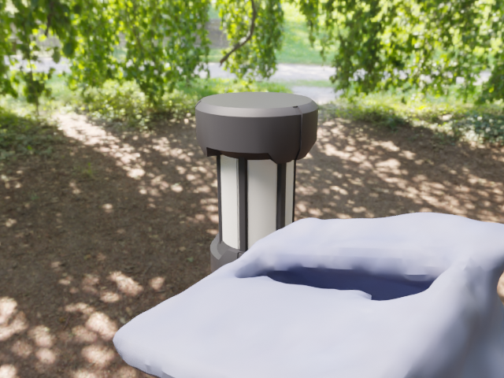
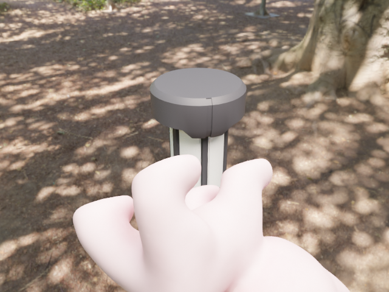

# BlenderProc 数据集工作区

当前版本：**tag2.01**（包版本 `2.0.1`）。支持应用与 Blender 内的场景/相机视角切换，几何预览与严格 GPU 渲染预览分离；提供环境配置教程及 `examples/` 下的任务与渲染结果示例。

面向 Ubuntu 22.04 的本地桌面工具：导入目标与遮挡物，设置相机、光照和遮挡率，导出独立脚本，在 conda `bop` 环境中用 GPU 批量渲染。输出 **RGB + mask + mask_visib** 或 **BOP**；用于 YOLO 时，由外部工具转换标签。

界面采用 Blender 风格，包含对象树、三维视口和独立相机窗口。基本流程是：**导入资源 → 设置采样 → 检查构图 → 导出任务 → 终端预检 → 小批量试渲染 → 完整渲染**。

## 安装与启动

以下面向首次在自己电脑上安装的用户，不需要作者的目录或现成环境。安装位置可以自选；命令以 `$HOME/projects/blenderproc-ui` 为例。

### 环境要求

| 部分 | 要求与用途 |
|---|---|
| 操作系统 | 以下教程针对 Ubuntu 22.04 x86_64；其他系统没有完成同等验证 |
| UI Python | Python 3.10+，Ubuntu 22.04 建议使用系统 Python 3.10，依赖装在仓库 `.venv` |
| 桌面 | 有效的图形桌面及硬件 OpenGL；纯 SSH 终端不能直接显示 Qt/Blender 窗口 |
| 任务启动器 | 独立 conda 环境 `bop`，Python 3.8，用于启动导出任务 |
| 实际渲染 | BlenderProc 2.8.0 + Blender 4.2.1 LTS；使用 Blender 内置 Python 3.11 |
| GPU | 已验证 NVIDIA OPTIX；其他后端需对应硬件和驱动，不支持 CPU 回退；BOP 另需 GPU EGL |

**UI、conda 启动器和 Blender 内置 Python 是三个独立环境。** 安装 UI 不等于配置好渲染环境；只有 UI 环境时可先导入模型、设置参数并查看应用内几何预览，打开 Blender 和生成数据集还需完成下方环境配置。

### 获取源码并安装 UI

在 Ubuntu 22.04 桌面终端执行：

```bash
sudo apt-get update
sudo apt-get install -y git python3.10 python3.10-venv

# 自选工作目录；已克隆仓库的用户跳过 git clone，直接进入自己的仓库
mkdir -p "$HOME/projects"
git clone https://github.com/Kepler123-yby/blenderproc-ui.git "$HOME/projects/blenderproc-ui"
cd "$HOME/projects/blenderproc-ui"
export BPROC_UI_ROOT="$PWD"

# 显式使用系统 Python，避免误用已激活的 Python 3.8 conda 环境
/usr/bin/python3.10 -m venv .venv
.venv/bin/python -m pip install --upgrade pip
.venv/bin/python -m pip install -e '.[gui]' -c constraints/ui.txt
.venv/bin/blenderproc-ui
```

Qt/OpenGL 系统库见下方“准备 Ubuntu 系统与 GPU”。若使用自定义 Python 3.10+，将 `/usr/bin/python3.10` 换成该解释器的真实路径。保持仓库源码在安装位置，`-e` 为可编辑安装，Blender 查看功能也需要仓库内的工具脚本。

### 后续启动或打开项目

不必激活虚拟环境，也不必先激活 conda。新开终端后，用自己的仓库路径启动：

```bash
export BPROC_UI_ROOT="$HOME/projects/blenderproc-ui"  # 若安装在其他位置，在这里替换
cd "$BPROC_UI_ROOT"
"$BPROC_UI_ROOT/.venv/bin/blenderproc-ui"

# 打开自己保存的项目，替换为实际 YAML 路径
"$BPROC_UI_ROOT/.venv/bin/blenderproc-ui" --project "$HOME/my-datasets/scene.yaml"
```

`bproc-ui` 是相同入口的简写。下面的命令若使用相对路径，均需先回到仓库根目录；`BPROC_UI_ROOT` 等变量只对当前终端有效，新开终端要重新设置。首次使用请选择自己的模型资源，在“脚本”页配置本机运行路径，导出后执行 `--check-only`；启动器不会联网补装依赖。仓库 `examples/` 内的任务是历史示例，不是新用户可直接运行的默认项目。

## 环境配置教程（参考华南虎 RM2023 开源文档）

参考 [《RM2023-华南理工大学-华南虎-工程视觉开源》](docs/RM2023-华南理工大学-华南虎-工程视觉开源.pdf) PDF 第 18–20 页“BlenderProc 渲染数据集制作方法”。原文的关键顺序是：**建立 Python 3.8 环境 → 安装 BOP toolkit → 安装 BlenderProc → 准备模型和背景 → 渲染及标注处理**。

原文第 4–5 页的 Python 3.6、ObjectDatasetTools、RealSense、OpenCV 4.6 属于另一条“实拍重建”流程，**不是本工具的安装依赖**。原文没有固定当前 BlenderProc/Blender 版本；下文按本项目已经验证的版本补齐，不把旧流程命令原样混用。

### 1. 准备 Ubuntu 系统与 GPU

以 Ubuntu 22.04 为例，先安装 NVIDIA 官方驱动并重启，再检查显卡：

```bash
nvidia-smi
sudo apt-get update
sudo apt-get install -y build-essential cmake git pkg-config libssl-dev \
  libgl1 libegl1 libglib2.0-0 libxkbcommon-x11-0 libxcb-cursor0 \
  libxcb-icccm4 libxcb-image0 libxcb-keysyms1 libxcb-render-util0 libxcb-xinerama0
```

`nvidia-smi` 应能列出 GPU 和驱动版本；UI 还需要有效桌面/OpenGL 会话。安装软件包通常需要联网，不必照搬原文对整机执行 `apt upgrade`。本项目实际 GPU 验证为 NVIDIA OPTIX；BOP 后处理还要求 NVIDIA EGL，不能落到 llvmpipe 等软件渲染器。Blender 自带运行组件，本文不要求另外安装某个固定 CUDA Toolkit。

### 2. 建立独立渲染环境，先装 BOP toolkit

如果还没有 conda，先按 [Miniconda 官方安装说明](https://www.anaconda.com/docs/getting-started/miniconda/install) 安装 Linux x86_64 版本，并按安装器提示初始化当前 shell；重新打开终端后，先用 `conda --version` 确认命令可用。不要求将 conda 安装到某个固定目录。

下面创建名为 `bop` 的环境；若已经有同名环境，先检查 `conda run -n bop python --version` 是否为 Python 3.8，不要覆盖已有环境。已有且符合要求时，跳过 `conda create`。模型、toolkit 与 Blender 的安装路径可按需调整：

```bash
conda create -n bop python=3.8 -y
conda activate bop
python -m pip install --upgrade pip setuptools wheel
mkdir -p "$HOME/blenderproc"
cd "$HOME/blenderproc"
git clone https://gitee.com/yu-chenghuan/Linemod-Render.git
cd Linemod-Render/bop_toolkit
python -m pip install -r requirements.txt
python -m pip install -e .
python -c "import bop_toolkit_lib; print(bop_toolkit_lib.__file__)"
```

保留该源码目录，稍后在 UI 填写其绝对路径。PDF 中的 `pip install -r requirments.txt -e` 存在文件名拼写及缺少安装目标的问题；这里针对实际含 `requirements.txt`、`setup.py` 的 toolkit 目录拆成两条命令。若下载到的分支结构不同，应以实际文件为准，不运行原文的残缺命令。

### 3. 安装固定版本 BlenderProc 与 Blender

```bash
# 仍在 conda bop 环境
python -m pip install blenderproc==2.8.0

# 下载并解压 Blender 官方 Linux x64 包
mkdir -p "$HOME/blender"
cd "$HOME/blender"
wget https://download.blender.org/release/Blender4.2/blender-4.2.1-linux-x64.tar.xz
tar -xf blender-4.2.1-linux-x64.tar.xz
export BLENDER_DIR="$HOME/blender/blender-4.2.1-linux-x64"
"$BLENDER_DIR/blender" --version
```

没有 `wget` 时可从 Blender 官方下载同一个压缩包再解压。本工具适配 **BlenderProc 2.8.0 + Blender 4.2.1 LTS**，Blender 内置 Python 为 **3.11**。conda 的 Python 3.8 负责启动任务，不是实际执行 `bpy` 的解释器；不要把 UI 安装到 `bop` 环境，也不要只在 conda 中安装依赖就认为 Blender 环境已经齐备。

### 4. 单独准备 Blender 内部 Python 依赖

先通过一个最小 BlenderProc 脚本准备默认依赖和离线缓存，再用它的 pip 入口补充依赖，不要直接用系统 `pip` 替代：

```bash
conda activate bop
export BLENDER_DIR="$HOME/blender/blender-4.2.1-linux-x64"
mkdir -p "$HOME/blenderproc/setup"
printf 'import blenderproc as bproc\nbproc.init()\n' > "$HOME/blenderproc/setup/prepare_env.py"
blenderproc run --custom-blender-path "$BLENDER_DIR" "$HOME/blenderproc/setup/prepare_env.py"
blenderproc pip install --custom-blender-path "$BLENDER_DIR" requests
```

`blenderproc run` 首次启动会准备其默认依赖（包括 NumPy、trimesh、pyrender、OpenCV 等），安装到 Blender 的 `custom-python-packages/` 并维护依赖缓存；`blenderproc pip install` 本身只安装显式指定的包，不能代替首次初始化。该准备脚本不生成数据集，不代表已经通过本应用的 GPU-only 验收。首次准备需要联网；不要把实拍流程的 OpenCV 4.6 强行装进这里。

BOP 模式另外需要在 **Blender Python** 中安装 toolkit 的依赖；本机采用与原文同源的本地 toolkit：

```bash
export BOP_TOOLKIT="$HOME/blenderproc/Linemod-Render/bop_toolkit"
blenderproc pip install --custom-blender-path "$BLENDER_DIR" \
  vispy glumpy triangle Cython pycocotools
```

本项目 BOP 运行时通过 UI 中填写的 toolkit 源码目录导入 `bop_toolkit_lib`；仅在 conda 中执行过 `pip install -e .` 不能替代这一步。基础 scipy、matplotlib、OpenCV、PyOpenGL/pyrender 等由 BlenderProc 默认环境提供，以上命令补充 toolkit 常用组件；**不要将旧 toolkit 的 requirements.txt 整份装进 Blender Python 3.11**，其中 scipy 1.5、matplotlib 2.2 等历史固定版本与当前环境不兼容。toolkit 不同分支的附加依赖可能不同，须按实际导入报错补齐并以任务 `--check-only` 为准。本文依据原文与本机适配器整理，没有在全新系统重装验证；启动器不会帮忙下载安装或自动修复环境。

### 5. 获取本机路径并连接 UI 与渲染环境

已经完成顶部 UI 安装的用户不必重复创建 `.venv`。先在终端激活渲染环境，查询真实路径，不要照抄作者机器的用户名或假设 conda 一定位于 `miniconda3/`：

```bash
conda activate bop
export BLENDER_DIR="$HOME/blender/blender-4.2.1-linux-x64"
export BOP_TOOLKIT="$HOME/blenderproc/Linemod-Render/bop_toolkit"
printf 'Conda 环境：%s\n' "$CONDA_DEFAULT_ENV"
printf 'BlenderProc CLI：%s\n' "$(command -v blenderproc)"
printf 'Blender 目录：%s\n' "$BLENDER_DIR"
printf 'BOP toolkit：%s\n' "$BOP_TOOLKIT"
test -x "$BLENDER_DIR/blender" && echo 'Blender 可执行文件存在'
test -f "$BOP_TOOLKIT/bop_toolkit_lib/__init__.py" && echo 'toolkit 源码存在'
```

如果安装在其他目录，先修改上述两个变量。确认 `command -v blenderproc` 的结果属于刚才安装的 `bop` 环境，而不是其他环境。在 UI“脚本”页按终端输出填写：

| 字段 | 如何填写 |
|---|---|
| Conda 环境 | 上述环境名，默认 `bop`；后续 `conda run -n` 使用同一名称 |
| Blender 目录 | `BLENDER_DIR` 的实际完整路径，选择安装目录，不是 `blender` 可执行文件 |
| BlenderProc CLI | `command -v blenderproc` 的实际完整路径，选择可执行文件 |
| BOP toolkit | `BOP_TOOLKIT` 的实际完整路径，目录内应含 `bop_toolkit_lib/` |

环境变量不会自动替你填写 UI。复制终端展开后的完整路径，不在路径框里原样填 `$HOME` 或 `$BLENDER_DIR`。即使 UI 中显示了默认路径，也需要检查它们是否与自己的安装一致。

然后回到仓库并启动 UI：

```bash
export BPROC_UI_ROOT="$HOME/projects/blenderproc-ui"  # 按实际克隆位置修改
cd "$BPROC_UI_ROOT"
"$BPROC_UI_ROOT/.venv/bin/blenderproc-ui"
```

RGB 双掩码格式不要求配置 BOP toolkit；若暂时不需要 BOP，可跳过 toolkit 的安装及专用依赖步骤，但 Blender 默认依赖仍须准备。

### 6. 准备资源并验证整个链路

原文使用 BOP 模型及 `blenderproc download cc_textures ./backgrounds` 下载的 CC 材质。本 UI 的资源入口不同：目标导入带面的 PLY，遮挡物导入 PLY/OBJ，环境导入 `.hdr`/`.exr`；**CC 贴图目录不能直接当作 HDRI 导入**。可使用自己的模型、[BOP 模型](https://bop.felk.cvut.cz/datasets/)及 Poly Haven HDRI，分别核对来源授权和 m/cm/mm 单位。此应用无需运行原文旧版 `main_lm_upright.py`。

先导入自己的资源，设置渲染中心、相机和输出名称；暂时没有遮挡物时，将“无遮挡样本”设为 100%。在 UI 检查配置，导出到新的任务目录，例如 `$BPROC_UI_ROOT/jobs/my-first-job`。再回到仓库根目录执行以下命令；UI 中的数据集名称在此示例设为 `dataset`：

```bash
cd "$BPROC_UI_ROOT"
conda run --no-capture-output -n bop python jobs/my-first-job/run_job.py --check-only

# 唯一的试渲染父目录，避免覆盖已有结果
TRIAL_ROOT="$BPROC_UI_ROOT/renders/trial-$(date +%Y%m%d-%H%M%S)"
conda run --no-capture-output -n bop python jobs/my-first-job/run_job.py \
  --num-scenes 1 --output "$TRIAL_ROOT"

# 默认 RGB 双掩码格式；名称不是 dataset 时替换最后一级目录
.venv/bin/python tests/blender/check_rgb_masks.py "$TRIAL_ROOT/dataset"
```

预检应通过且不创建数据集。实际任务结束后检查 `run_metadata/status.json`，并用下文检查器验证图片与标注。BOP 模式还应看到日志中的两个 `BOP EGL renderer` 检查均为真实 GPU。原文手动调用 `calc_gt_masks.py` / `calc_gt_info.py` 是旧流水线的步骤；本项目 BOP writer 已完成对应掩码及 GT 信息后处理，不要再次无差别覆盖标注。COCO/Linemod_preprocessed 转换不属于本工具输出职责。

## 第一次生成数据集

### 1. 导入目标，指定渲染中心

在“资源”页选择正确的 **m / cm / mm** 单位，再导入一个或多个 PLY。目标必须包含三角面或可三角化的面，纯点云不能直接渲染。导入后核对显示的实际尺寸；单位不对时修改单位并等待重新加载。

- 每个启用目标在场景中出现一次，`obj_id` 是唯一正整数，用于输出类别映射。
- 选中一个目标并“设为渲染中心”。对象树的编辑选择与渲染中心分别控制。
- 中心目标的包围盒中心位于世界原点；其他目标的包围盒中心按各自 X / Y / Z 范围随机摆放，数值单位为米。
- 保留模型的 CAD 原点与原始朝向；当前不随机旋转目标。需要某几个方向的数据时，限制下一步的相机角度。

所有启用目标都需要完整入画且有可见像素。布局使用保守包围盒碰撞检查，凹模型也可能因包围盒重叠而被拒绝。

### 2. 设置球坐标相机

进入“采样”页，先用“适配距离”按中心目标的尺寸设置距离，再在相机窗口核对所有目标是否入画。多个目标分散时，需要进一步扩大距离或调整摆放范围；“恢复建议范围”会重设布局和机位范围。

| 参数 | 含义 |
|---|---|
| 半径 `r` | 相机到中心目标包围盒中心的距离，单位米 |
| 方位角 `φ` | `0°` 沿目标 +X，`90°` 沿 +Y |
| 仰角 `α` | `0°` 水平，`90°` 从 +Z 上方拍摄 |

例如，只需要 +X 一侧的斜上方视图，可设 `φ = -45° … 45°`、`α = 10° … 45°`，距离按模型尺寸调整。相机始终看向中心目标。`170° → -170°` 表示跨界的 20°；角度两端相等表示固定值，完整一周需要勾选“全方位”。随机方向对 `φ` 和 `sin(α)` 均匀采样，半径均匀采样。

**固定机位与随机采样二选一：**

- 固定机位：列表中每个机位各拍一张，可通过“用当前视角添加”保存正在看的机位。
- 随机采样：填写每场景视角数，在一个或多个球坐标区域抽样；多个区域均分视角数，余数按列表顺序分配。

总请求张数 = 场景数 × 每场景视角数。固定模式的每场景视角数等于机位数量。例如，10 个场景、每场景 4 个视角，共请求 40 张。同一场景共享目标位置、光照、HDRI 和目标材质，每个视角重新生成相机与遮挡物；固定机位的相机数值保持固定。

“无遮挡样本”的分类也按场景确定，小批量会取整。因此只试 1 个场景时，不一定同时包含无遮挡和有遮挡样本。

### 3. 导入遮挡物，选择尺寸策略

遮挡物支持 PLY / OBJ，**导入单位独立于目标，默认 mm**。按源文件选择单位，查看换算后的尺寸。同一路径重复导入只保留一个资源。

| 策略 | 尺寸与姿态 | 适用方式 |
|---|---|---|
| 按物理尺寸 `physical_view` | 实际米制尺寸 × 倍率；随机三维旋转；每帧无放回选取资源 | 新建项目默认。倍率 1–1 保持实物尺寸，近远机位不会自动改变物体大小 |
| 按视角表观尺寸 `aimed_view` | 按相对目标的表观尺寸调整物理大小；不随机旋转；允许重复使用同一资源 | 需要控制画面中遮挡物大小时使用；未写策略字段的旧 YAML 保留此行为 |

新项目默认每帧 1 个物理遮挡物。数量上限不能超过不同资源数；需要遮挡时，下限至少为 1。物体放不下或发生碰撞会重试，不会自动缩小物体或减少数量。

在“中心目标的遮挡约束”中设置：

- **无遮挡样本**：要求中心目标完全没有额外遮挡的场景比例，默认 20%。首次只验证模型与相机、尚未导入遮挡物时，设为 **100%** 即可。
- **其余遮挡率**：有遮挡场景的中心目标像素遮挡率，默认 10%–50%。其他目标与专门遮挡物都计入，自遮挡不计入。
- **重试预算**：每个视角的几何提案与实际像素验收共享预算，默认 30 次。目标布局有独立的场景重试预算。

遮挡率按 `1 − 中心目标可见像素数 / 该目标单独渲染的轮廓像素数` 计算，只约束渲染中心。其他目标必须有可见像素，但不要求落在同一个遮挡率区间。几何预览估算构图，最终以实际渲染的像素验收为准。

### 4. 设置环境、材质与 GPU

可添加或扫描 Poly Haven 等来源的 `.hdr` / `.exr`，设置环境强度、旋转，以及点光源功率、距离和色温。HDRI 用作背景与照明；当前不导入完整房间或生成实体地面。不选 HDRI 时使用中性灰世界背景。

目标材质支持粗糙度、金属度、高光的随机范围或指定值；基色可跟随模型原色，也可统一指定。材质按场景共享。

“脚本”页的 Cycles 设置默认使用 **OPTIX**，可选 CUDA / HIP / ONEAPI / METAL。渲染禁用 CPU 设备；指定后端不可用时停止。当前实际硬件验收为 NVIDIA OPTIX，其他后端需要在对应机器上预检。

表面处理可选择平直、平滑、按角度平滑，并启用加权法线。降噪的“自动 GPU”仅在 OPTIX 后端启用 OptiX 降噪，其他后端自动模式关闭降噪。详见 [GPU 与表面处理](docs/gpu-rendering.md)。

### 5. 预览、保存与导出

在底部“采样机位”栏选择 **场景编号、视角编号和预览种子**，总览与独立相机窗口同步显示同一个候选。固定模式的视角编号对应机位列表，随机模式保留全部区域的视角分配；切换编号不改变项目参数。独立相机窗口关闭后，用“视图 → 相机视角”或 UI 中的 F12 重开。

点击“在 Blender 中打开当前构图”，默认进入 **SOLID 几何相机视图**，无需先通过 GPU/降噪检查。在 Blender 三维视口按 **N → BlenderProc → 场景 / 相机预览**，选择场景与视角后点“更新候选”，通过“相机视图”与“场景总览”检查构图、物体布局及相机位置/朝向；面板同时显示相机、灯光和环境参数。

需要真实光照和材质时，点击 **“渲染预览（严格 GPU）”**。该入口验证 GPU 与降噪组合，失败时给出修改建议并保留几何视图，不回退 CPU。生成的 `.blend`、配置快照和日志保存在项目同级 `.blender-view/`；直接双击 `.blend` 不会自动注册面板，请从应用或命令行入口重新打开。场景参数在原应用修改，不做 Blender 反向同步。

两端显示的都是 **候选预览，未经像素遮挡验收**。正式生成可能因像素验收而重试，不保证最终接受帧与当前候选完全相同。

按 Ctrl+S 保存项目 YAML，再“检查配置”。在“脚本”页选择格式、数据集父目录与名称，填写：

- Conda 环境：已有的 `bop`。
- Blender 目录：包含 `blender` 和 `4.2/python/bin/python3.11` 的安装目录。
- BlenderProc CLI：对应 `bop/bin/blenderproc`。
- BOP toolkit：BOP 输出需要本地 toolkit 和可用 GPU EGL；RGB 双掩码格式不需要 toolkit。

导出到一个**尚不存在的任务目录**。任务包含 `scene.yaml`、`run_job.py`、渲染入口与运行时，关闭 UI 后仍可执行。模型和 HDRI 使用绝对路径引用，没有复制进任务包；移动资源后需要更新项目并重新导出。

### 6. 在终端预检、试渲染和正式渲染

以下路径需要替换成自己的任务目录和输出目录：

```bash
# 检查实际 Blender Python、资源与 GPU 依赖
conda run --no-capture-output -n bop python /任务目录/run_job.py --check-only

# 先渲染 1 个完整场景，使用独立输出位置
conda run --no-capture-output -n bop python /任务目录/run_job.py \
  --num-scenes 1 --output /新的试渲染父目录

# 检查小样本后，按导出的 YAML 执行完整任务
conda run --no-capture-output -n bop python /任务目录/run_job.py
```

`--output` 指**父目录**，实际结果位于 `<父目录>/<dataset_name>`。试渲染与正式渲染要使用不同的最终目录。已有结果目录即使为空也拒绝覆盖；中断后换新目录运行，目前不支持断点续跑。

可用 `--format rgb_masks` 或 `--format bop` 临时覆盖输出格式。试渲染推荐 `--num-scenes N`；旧 `--num-samples` 会折算成整场景，不能保证恰好输出指定张数，也不能与 `--num-scenes` 同用。普通采样参数可编辑导出任务的 `scene.yaml`，环境路径或应用代码更新后应重新导出。

## 仓库中的人工测试素材

用户已完成人工测试，当前仓库保存以下任务与结果，替换原先的六帧示例：

| 素材 | 内容 |
|---|---|
| [导出任务 examples/jobs/render_job](examples/jobs/render_job/) | `cores` 目标（`obj_id=1`，单位 m），15 个遮挡物资源（单位 mm），979 个 HDRI 路径；随机模式 **250 场景 × 4 视角 = 1000 张请求** |
| [试渲染 examples/renders/preview/dataset](examples/renders/preview/dataset/) | **1 场景 × 4 视角**，640×480，OPTIX、50 samples、自动降噪；`completed`，requested=4、saved=4、skipped=0、exit_code=0 |

任务使用物理尺寸遮挡策略，每帧 1 个遮挡物、物理倍率 1；项目设定无遮挡场景比例 20%、其余遮挡率 10%–50%。场景比例在小样本中会取整，本次四帧实测遮挡率约为 **20.80%、29.70%、10.54%、29.97%**。1000 张是导出任务的配置规模，**不是已完成的渲染数量**。

| RGB 构图 | 完整掩码 `mask` | 可见掩码 `mask_visib` |
|---|---|---|
|  |  |  |
|  |  |  |

其余视角及逐帧相机、摆放与遮挡率见 [manifest.json](examples/renders/preview/dataset/run_metadata/manifest.json)，完成状态见 [status.json](examples/renders/preview/dataset/run_metadata/status.json)。

```bash
# 在本机资源路径和运行环境有效时，检查示例任务
conda run --no-capture-output -n bop python examples/jobs/render_job/run_job.py --check-only

# 一个完整场景的试渲染；必须使用尚不存在的最终数据集目录
conda run --no-capture-output -n bop python examples/jobs/render_job/run_job.py \
  --num-scenes 1 --output /新的试渲染父目录

# 只读检查仓库现有四帧结果
.venv/bin/python tests/blender/check_rgb_masks.py examples/renders/preview/dataset
```

`examples/jobs/` 与 `examples/renders/` **仅作导出结构和结果示例**，不作为默认运行目录。历史快照内的绝对路径保持原样；新任务请导出到根目录 `jobs/`，新结果写入根目录 `renders/`，不要覆盖示例。任务包含导出时的运行时代码快照；模型、HDRI 和运行环境仍引用原机器的绝对路径，**未随仓库打包**。其他机器请在应用中替换资源与环境路径并重新导出，不要把示例任务当成开箱即用的数据包。

## 输出格式与标签

| 内容 | RGB + mask + mask_visib | BOP |
|---|---|---|
| RGB | 默认 PNG，可选 JPEG | 默认 JPEG，可选 PNG |
| 完整 / 可见掩码 | 每个目标各一张二值 PNG | 每个 GT 实例各一张二值 PNG |
| 深度、相机与 GT、模型 | 不生成 BOP 文件结构；运行元数据仍保留相机与摆放信息 | 深度、`scene_camera.json`、`scene_gt.json`、`scene_gt_info.json`、`models/` |
| 掩码文件后缀 | 稳定对象 `obj_id` | 该图 `scene_gt` 列表的零起始索引 |

两种格式的掩码均为单通道 8 位 PNG：背景 0、前景 255。`mask` 表示目标单独渲染的完整轮廓，`mask_visib` 表示其可见部分；BOP 可见掩码使用原生深度容差计算，不应直接当作采样验收的精确分割遮挡率。

例如，对象 ID 为 2 和 7 时，轻格式包含：

```text
dataset_name/
  rgb/000000.png
  mask/000000_000002.png
  mask/000000_000007.png
  mask_visib/000000_000002.png
  mask_visib/000000_000007.png
  run_metadata/
```

BOP 图像与标注位于 `train_pbr/000000/` 等场景目录，相应掩码后缀通常为 `000000`、`000001`，需通过 `scene_gt.json` 映射到对象 ID。BOP 模型坐标与位姿平移使用毫米；16 位深度 PNG 恢复为米的公式是 `像素值 × depth_scale / 1000`，其中 `scene_camera.json` 的 `depth_scale` 对应项目的 `depth_scale_mm`，默认 0.1。

运行结果先看 `run_metadata/status.json` 中的 `requested`、`saved`、`skipped` 和失败原因。`frames.jsonl` 逐帧记录元数据，`manifest.json` 在结束时汇总，`rejections.jsonl` 记录拒绝原因。BOP 后处理完成后才计入保存成功。

| 退出码 | 状态与处理 |
|---|---|
| 0 | `completed`：全部请求完成 |
| 2 | `partial`：重试耗尽等原因导致部分或全部请求未保存；查看拒绝原因 |
| 1 | `failed` 或启动失败：查看终端错误与日志 |
| 130 / 143 | SIGINT / SIGTERM 中断；等待当前原生渲染与必要收尾后退出 |

## 多尺度目标与大模型

- **按尺寸分组**：启用目标最长边相差超过 10× 时，可在“脚本”页勾选按组导出，让每组单独生成数据集。它是改善取景与深度容差的可选工作流；如果需要大小目标出现在同一场景，保持不勾选。
- **分组后自动重取景**：默认关闭。启用后，实际拆成多组时重算各组相机距离，并相应调整点光源距离和功率；内参、ID、遮挡率和深度编码保持原配置。每组的调整记录写入 `grouping.json`。
- **自动 LOD**：只简化视口显示，默认对超过 10 万面的网格生成最多 5 万面的显示网格。实际采样、导出和渲染使用完整模型。
- **图像分块**：Cycles 默认开启，分块尺寸 2048，用于减少高分辨率图像缓冲占用；全部场景几何仍需驻留显存。

分组也可在命令行执行：

```bash
# 只查看分组结果
.venv/bin/python tools/export_by_scale.py /项目路径/scene.yaml /新的任务目录 --dry-run

# 按组导出并自动重取景，画幅四周留 10% 边距
.venv/bin/python tools/export_by_scale.py /项目路径/scene.yaml /新的任务目录 \
  --reframe-groups --framing-margin 0.10
```

多组会生成带 `-size-N` 后缀的任务目录和数据集名称，逐个使用各自的 `run_job.py`。只有一组时保留原配置。

## 常见问题

| 现象 | 检查方法 |
|---|---|
| 物体极小、相机离得很远 | 核对 m/cm/mm 与显示尺寸，重新适配距离 |
| 新项目未导入遮挡物，检查不通过 | 若暂时只拍无遮挡数据，把“无遮挡样本”设为 100% |
| `out_of_frame` / `collision` | 调整目标位置范围与相机距离；布局检查使用保守包围盒 |
| `no_occluder_room` / `occluder_collision` | 核对遮挡物单位、物理倍率、数量与相机距离；物理模式不自动缩小资产 |
| `occlusion` / `invisible_target` | 查看实际遮挡率和候选构图，调整允许范围、遮挡物或目标布局；增加重试不能解决无解配置 |
| GUI 能预览，终端却报依赖或 GPU 错误 | 预览与实际渲染使用不同环境，先运行任务的 `--check-only` |
| 修改材质后视口差别很小 | 在 Blender 中查看真实光照；模型顶点色很暗时可试“统一基色” |
| Qt 无法载入 xcb 插件 | 按 [使用说明](docs/usage.md#安装与启动) 检查桌面系统库 |

## 致谢

感谢 **华南理工大学华南虎战队** 开源工程视觉方案，并在 [《RM2023-华南理工大学-华南虎-工程视觉开源》](docs/RM2023-华南理工大学-华南虎-工程视觉开源.pdf) 中分享数据集制作、BlenderProc 渲染及环境配置经验。这些资料为本项目的环境配置教程与数据集制作流程提供了重要参考。

相关开源项目：[Linemod-Render](https://gitee.com/yu-chenghuan/Linemod-Render)、[Linemod-Real](https://gitee.com/yu-chenghuan/Linemod-Real)。感谢战队及相关贡献者对 RoboMaster 视觉技术交流与开源生态的贡献。

## 验证与更多说明

安装开发依赖后运行单元与 Qt 测试：

```bash
.venv/bin/python -m pip install -e '.[gui,dev]' -c constraints/ui.txt
env -u PYTHONPATH -u DEBUG PYTEST_DISABLE_PLUGIN_AUTOLOAD=1 \
  QT_API=pyside6 QT_QPA_PLATFORM=offscreen \
  .venv/bin/python -m pytest -p pytestqt.plugin tests/unit tests/ui -q
```

检查真实输出时，将路径指向包含 `run_metadata/` 的数据集根目录，按格式选择一个检查器：

```bash
.venv/bin/python tests/blender/check_rgb_masks.py /RGB双掩码数据集路径
.venv/bin/python tests/blender/check_bop.py /BOP数据集路径
```

v1.1 自动验收：**775 项单元与 Qt 测试通过**；真实 Blender 4.2.1 烟测覆盖后台构建、GUI 面板注册、场景/视角往返切换、相机矩阵、对象复用和视口状态，见 [场景/机位预览验证](docs/scene-camera-preview-verification.md)。用户另已完成人工测试，上方 `examples/renders/preview/dataset` 保存了四帧实际渲染结果；`examples/jobs/render_job` 保存对应配置来源的完整导出任务。历史 GPU 与算法检查见 [验证记录](docs/validation.md)。

详细设置见 [使用说明](docs/usage.md)、[GPU 与表面处理](docs/gpu-rendering.md)。设计与实施计划保存在 [docs/superpowers/](docs/superpowers/)。
