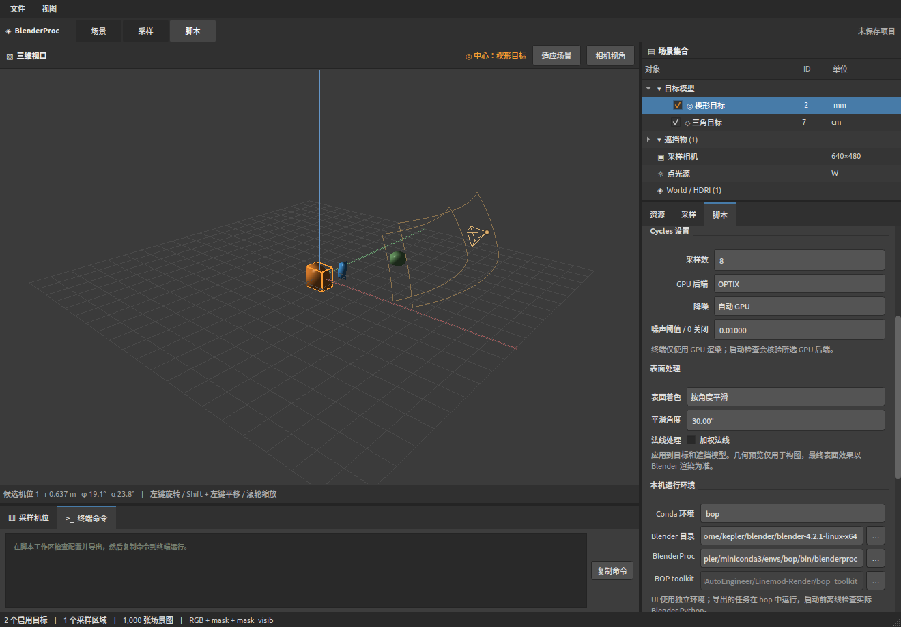
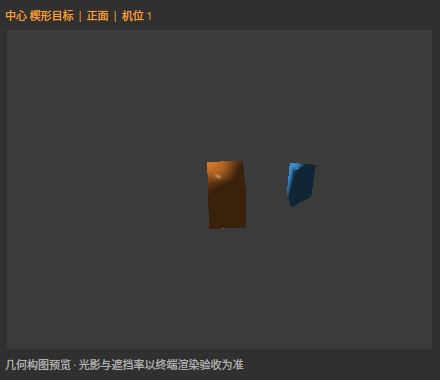
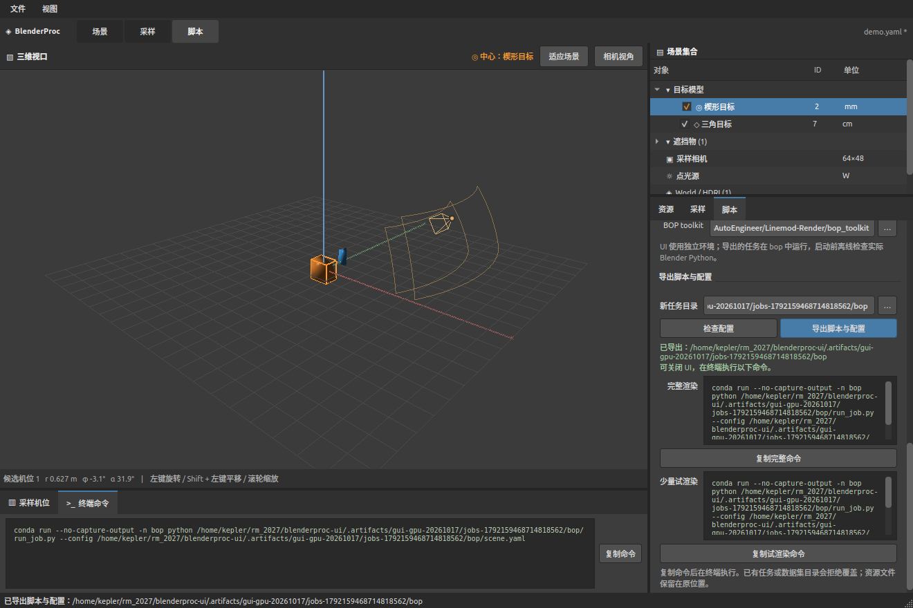
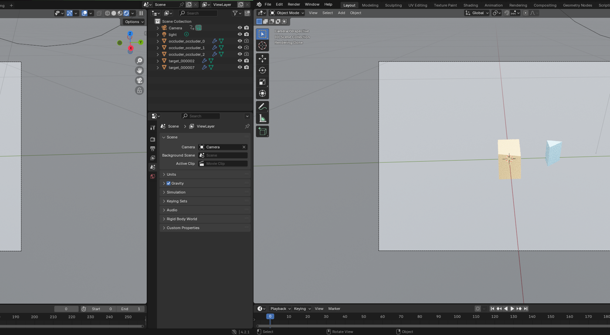

# 验证记录

2026-10-16 在本机 Ubuntu 22.04.5 x86_64 完成。机器可读证据见 [validation-evidence.json](validation-evidence.json)，桌面截图见下方；完整运行记录保留在本机 `.artifacts/`，不纳入 Git。







## 已验证结果

| 检查 | 实际结果 |
|---|---|
| 单元与 Qt 测试 | **388 passed**，12.8 s（含 GPU、PLY、无 HDRI、Blender 查看、场景/视角、布局策略与重试、遮挡策略、目标材质、遮挡物沿机位、视图身份、运行生命周期、元数据 journal、异步导出） |
| RGB + mask + mask_visib | 同场景两个目标 ID 2 / 7，4 / 4 完成，语义检查通过 |
| BOP | 4 / 4 完成；深度、K、位姿、模型毫米坐标、GT 索引和 gt_info 检查通过 |
| 无 BOP toolkit 的轻格式 | toolkit_path=None，离线预检及 4 / 4 渲染通过 |
| 目标材质 | 粗糙度 0.03 / 0.95 各渲染 1 帧：中心像素 40 → 58，`candidate.material` 写入 manifest；遮挡物未变 |
| 近距离 BOP | 相机半径 35 mm，深度最大 36.3 mm；后处理未被固定 0.1 m 近裁剪面截空 |
| 无法满足的布局 | 恰好 30 次碰撞拒绝；saved=0、skipped=1、partial、退出码 2 |
| 已有输出目录 | 拒绝再次运行，退出码 1；结果树 SHA256 保持一致 |
| SIGINT / SIGTERM | 两者均保存 1 张、跳过 999 张，状态 interrupted，进程退出码分别 130 / 143 |
| 核心与 Blender 投影 | 非对称 fx/fy、偏置 cx/cy；与 bpy.calc_matrix_camera 最大误差 0.0000022 px |
| 实际 GPU 相机视口 | 与 Blender 相机投影误差 0.0301 px，与实际 Blender 标记图误差 0.25 px，均小于 1 px |
| 原生桌面 GUI | 真实 OpenGL，1320×920 和 1024×768 截图；相机重开复用 canvas；切换中心、保存、两种导出通过 |
| 独立任务 | 从 `/tmp`、移除 PYTHONPATH，使用 conda Python 3.8 启动预检及渲染通过 |
| 命令与目录 | 中文、空格、单引号、字面 `$()` 路径；空目录、文件、软链接、断链保护测试通过 |
| 编译与依赖 | compileall、3.8 启动器 py_compile、pip check、git diff --check 通过 |
| GPU 设备选择 | 真实 OPTIX 渲染；日志 `以 GPU 渲染` 且 CPU 设备被关闭，未回退 CPU |
| BOP EGL 硬件校验 | 两个 EGL 上下文均读到 NVIDIA GeForce RTX 3060 Ti；软件渲染器拒绝由注入身份的用例覆盖 |
| GPU BOP 端到端 | 独立导出的 BOP 任务 4 / 4 完成，退出码 0，掩码、深度、GT 有效 |
| Blender 查看当前构图 | 后台 Blender 重建并写 `scene.blend`，另起 GUI 进程打开；相机点位与候选一致，视图为渲染着色 |
| 未选环境图的项目 | 去掉 HDRI 的同一演示项目通过校验、导出、运行：1 / 1 帧写出，退出码 0，世界背景为中性灰 0.05，不是黑屏 |
| 无 HDRI 的运行记录 | `run_metadata/manifest.json` 与 `status.json` 的 `world` 为 `{"kind":"neutral","color":[0.05,0.05,0.05]}`，候选 `hdri_path` 为 null |
| n 边形与带边 PLY | `~/文档/cores.ply` 读到 1035 顶点、1837 面，不再读成空网格 |
| 视口 HUD 比例 | 网格与坐标架按导入几何的包围盒缩放（0.1 mm 下限），复用同一组 visual 更新数据，缩放后不再残留旧坐标架 |
| 滚轮与数值 | 数值框 `StrongFocus` + 事件过滤器：未聚焦时滚轮滚动面板而不改数值；聚焦后才步进 |
| 打开既有项目 | 相机距离与模型尺度相差 1.6 倍以上时自动适配到 `0.9–1.4 ×` 适配距离，用户随后手改的值不会被再次覆盖 |
| 固定机位模式 | `camera_mode: fixed` + 2 个机位 + 2 场景 = 4 张：每场景两个视角，视角 0 恒为机位 A、视角 1 恒为机位 B，r/φ/α 与设定完全一致 |
| 场景内摆放固定、机位随机 | `scene_count: 2`、`views_per_scene: 3`、1 个区域：6 张全部 saved，同场景三帧的 `placements` 与 `light` 完全一致，`azimuth_deg` 分别为 −22.0° / 137.4° / 154.7°，退出码 0 |
| 无遮挡物时的遮挡要求 | 修掉空遮挡物清单下“ratio 永远到不了下限”的死循环：5 / 5 帧写出，`rejections.jsonl` 为空 |
| 遮挡物覆盖目标 | `.artifacts/demo/workspace.yaml` 渲染 2 帧：遮挡率 0.198 / 0.426（窗口 0.1–0.5），2/2 写出；修复前同一项目 30/30 次因 `occlusion` 被拒、0 帧 |
| 机位距离随模型缩放 | `fit_radius_m` 与归一化包围盒成正比；`suggest_layout` 的 `framing_band` 不再把 1 mm 模型放到 5 cm 之外 |
| 建议范围可摆放多目标 | `suggest_layout` 给每个启用目标独立的 X 区间（间隔 ≥ 最大目标尺寸 10%），250 组抽样 0 次 AABB 重叠；相机距离按全部目标联合包围盒的角点投影求解 |

测试演示由本地 Blender 生成 HDRI，并使用偏置 CAD 原点的 mm / cm 目标及 m 遮挡物；单元测试另覆盖三种单位。演示是合成网格，尚未使用用户自己的生产模型和 Haven 资源批量验证。

## GPU 验收（2026-10-17）

任务要求：渲染只用 GPU，并保证 BOP 那套独立的 EGL 后处理也不会落到软件光栅化上。两件事分开检查，因为 Cycles 设备和 pyrender 的 EGL 上下文没有共用状态。

规则与参数说明见 [GPU 与表面处理](gpu-rendering.md)。

| 检查 | 实际结果 |
|---|---|
| Cycles 设备 | `GPU rendering: OPTIX — NVIDIA GeForce RTX 3060 Ti; CPU devices disabled`；初始化与每个渲染 pass 前复检 |
| OptiX 降噪 | 本机支持并实际渲染；CUDA + OptiX 降噪在 Blender 4.2 会走 CPU，已被禁止 |
| BOP EGL 探测 | 直接用原生 `_pyrender_init` 函数体建两个上下文：`NVIDIA Corporation / NVIDIA GeForce RTX 3060 Ti/PCIe/SSE2 / 4.1.0 NVIDIA 580.178.04`，深度像素 121 / 1122 |
| GPU RGB 任务 | 独立导出的 rgb_masks 任务 4 / 4 完成，退出码 0 |
| GPU BOP 任务 | 独立导出的 BOP 任务 4 / 4 完成，退出码 0；深度 0–6336（0.1 mm 单位）、mask 57–78 像素、mask_visib 24–60 像素、`visib_fract` 与 GT 一致 |
| 软件渲染器拒绝 | 单元测试注入 llvmpipe / softpipe / swrast / lavapipe / SwiftShader / GDI Generic 与缺失身份，全部拒绝；本机 NVIDIA 驱动不接受 Mesa 软件覆盖，因此没有真实 llvmpipe 上下文的拒绝实测 |

证据：`.artifacts/gpu-probe/`（EGL 探测、Cycles 设备、OptiX 降噪）、`.artifacts/gpu-e2e/`（两个独立任务与日志）、`.artifacts/gpu-quality*/`（表面处理对照）。`tests/blender/check_render_quality.py` 对同一场景比对平直 / 平滑 / 按角度平滑的渲染差异。上方截图均为 GPU 版界面，在真实桌面 OpenGL 会话中捕获。

## 帧元数据写入（2026-10-18，schema 2）

审计发现 400 帧数据集最终约 1.13 MB，却在运行中累计写入约 225.94 MB、耗时约 10 秒：每帧重写整份
`manifest.json` 让写入呈平方增长。现在每帧只向 `run_metadata/frames.jsonl` 追加一行（写完立即
flush + fsync 才计入已提交），`manifest.json` 只在 `finish` 时原子生成一次并带 `final: true`；
`read_frame_records()` 优先读 journal，一旦存在最终 manifest 就核对帧数与帧号一致。

用 `JsonRunRecorder` 直接回放固定长度记录（不含渲染）测量，写入量与帧数严格线性：

| 帧数 | journal 字节 | 累计写入字节 | 耗时 |
|---|---|---|---|
| 100 | 86 590 | 256 121 | 0.82 s |
| 200 | 173 290 | 512 121 | 1.43 s |
| 400 | 346 690 | 1 024 121 | 2.83 s |

400 帧的累计写入从约 225.94 MB 降到约 1.02 MB（约 1/220），耗时从约 10 秒降到 2.8 秒；每帧
journal 行约 866 字节且不随帧数变化。旧版无 journal 的 manifest 仍可只读兼容，不做原地迁移。
测量脚本与原始数据在 `.artifacts/metadata-bench/bench.json`（本地产物，不进仓库）。

## Blender 查看（2026-10-17）
目标：导入的文档模型在视口里不显示时，不必等终端试渲染才能判断建模与光照。做法是后台用 Blender 自身的 Python 重建场景并保存 `.blend`，再另起一个 Blender 打开它；打开文件也会跳过启动画面，否则画面被 splash 挡住。

| 检查 | 实际结果 |
|---|---|
| 后台重建 | `--background` 进程跑通，日志为 OptiX 设备选择结果，`scene.blend` 写入成功 |
| 视图设置 | `viewport: rendered camera view in 1 area(s)`；相机视角 + 渲染着色，无启动画面 |
| UI 链路 | 导出工作区按钮走线程池重建后再开窗，成功/失败都更新面板文字 |
| 失败路径 | 构建失败抛 `Blender 构建场景失败（退出码 N）` 并带日志尾部；脚本异常不再关掉 GUI 窗口 |
| 缺少 HDRI | `str(None)` 不再进入 `images.load`；没有环境图时断开环境贴图连线、背景改中性灰，面板追加提示 |



图中的场景来自演示项目 `.artifacts/demo/demo.yaml`：相机、灯光、三个遮挡物与两个目标都在对象树里，机位是 UI 当前选中的候选。命令行的等价入口是 `tools/open_blender.py`。

## 环境

| 部分 | 版本 |
|---|---|
| UI Python | 3.10.12，独立 `.venv` |
| PySide6 / VisPy | 6.8.3 / 0.15.2 |
| NumPy / trimesh | 1.26.4 / 4.12.2 |
| PyYAML / Pillow | 6.0.3 / 11.3.0 |
| pytest / pytest-qt | 8.4.2 / 4.5.0 |
| conda bop Python | 3.8.20 |
| BlenderProc / Blender | 2.8.0 / 4.2.1（内部 Python 3.11.7） |

桌面依赖仅安装进仓库 `.venv`。没有向原 `bop`、Blender Python 或原 `dataset_rendering` 项目安装依赖。渲染使用已有的离线依赖和本地 BOP toolkit。CPU 路径已被产品逻辑禁用，实际渲染只走 GPU；AMD / Intel / Apple 后端有选项和启动检查，但没有对应硬件可测。

## 复验

```bash
env -u PYTHONPATH PYTEST_DISABLE_PLUGIN_AUTOLOAD=1 \
  QT_API=pyside6 QT_QPA_PLATFORM=offscreen \
  .venv/bin/python -m pytest -p pytestqt.plugin tests/unit tests/ui -q

.venv/bin/python tools/create_demo.py .artifacts/demo-new
.venv/bin/python tools/gui_smoke.py \
  --project .artifacts/demo-new/demo.yaml --output .artifacts/gui-new

# GPU 端到端：导出独立任务并直接渲染（两个格式各跑一次）
env -u PYTHONPATH .venv/bin/python tools/render_demo.py \
  --project .artifacts/demo/demo.yaml --destination .artifacts/e2e/rgb \
  --format rgb_masks --num-samples 4 --run
env -u PYTHONPATH .venv/bin/python tools/render_demo.py \
  --project .artifacts/demo/demo.yaml --destination .artifacts/e2e/bop \
  --format bop --num-samples 4 --run
```

`render_demo.py` 拒绝已存在的任务目录，输出 `任务目录` 与 `运行命令`；`--device` 可覆盖后端，不传时沿用项目设置（`CPU` 在载入时迁移为 OPTIX）。BOP 运行后看日志里两行 `BOP EGL renderer:` 确认没落到软件光栅器。

本机 shell 的 ROS PYTHONPATH 会自动加载无关 pytest 插件，测试命令显式隔离它；没有为解决此问题安装 ROS 依赖。GUI smoke 必须在真实桌面运行，不能使用 Qt offscreen。

在 UI 导出新任务后，复制其命令先 `--check-only`，再以 4 张小样本和独立输出父目录试渲染。只读检查器可用于实际结果：

```bash
.venv/bin/python tests/blender/check_rgb_masks.py /数据集路径
.venv/bin/python tests/blender/check_bop.py /BOP数据集路径
.venv/bin/python tests/blender/verify_runtime.py /任务目录
.venv/bin/python tests/blender/check_failures.py \
  --project .artifacts/demo/demo.yaml --destination .artifacts/acceptance-new
```

投影证据分别由 `tools/render_projection_fixture.py`（通过 BlenderProc 执行）和 `tools/check_viewport_projection.py`（真实 Qt OpenGL）生成；命令参数见各工具 `--help`。渲染入口必须在已通过离线预检的环境执行。

## 实施与审查修复

独立审查发现并已复验关闭四项问题：大整数种子导致 Qt 溢出、修改其他字段造成微小数值精度丢失、点云未在导出前拒绝、fork 后处理进程继承父级信号处理导致无法终止。回归测试分别覆盖 2**72 种子、微米级范围、导出后资源被替换，以及真实 fork 初始化阻塞后的终止。

真实中断测试还暴露了 BlenderProc 原生进度线程与 bpy 中途抛异常的问题。后端避开其进度线程，并将中断延迟到当前原生渲染调用结束，再完成已接受帧的提交与后处理。因此 Ctrl+C 可能需要等待当前渲染 pass 结束；不会声称立即取消，也不会把未完成的 BOP 后处理计为成功。

实现使用原生协作工具并行落实模块，接口稳定后集成验证。初始依赖下载期间先实现后补齐测试，没有执行计划中每一项“先红后绿”的历史命令；提交按模块合并，不伪造逐任务红测试或逐任务提交记录。

## 本轮修复的验收（2026-10-22）

环境：`.venv` Python 3.10.12 / PySide6 6.8.3 / vispy 0.15.2 / trimesh 4.12.2；运行环境 `bop` Python 3.8.20 / BlenderProc 2.8.0 / Blender 4.2.1 LTS；GPU 为 RTX 3060 Ti（OPTIX，CPU 设备禁用，BOP 走 NVIDIA EGL）。全量 unit/Qt 回归 **434 passed**（17.2 s，offscreen + `pytestqt`）。

证据目录 `.artifacts/handoff-20261022/` 与 `.artifacts/review4/`（任务、结果与日志都在这里；旧审计快照未被改动）。两者都在 `.artifacts/` 下，已被 `.gitignore` 忽略，重新生成的任务不会进仓库。

两个不同的比率，全文按这两个名字使用：**提案接受率** = 保存帧数 ÷ 提案总数（含被拒提案），衡量采样器好不好抽；**出图率** = `saved ÷ requested`，衡量任务有没有完成。下面每一行证据都满足 `requested = saved + skipped`，没有第三种去向。

| 用例 | 规模 | 退出码 | 结果 | 检查器 |
|---|---|---|---|---|
| 原 cores RGB | 2 场景 × 3 视角 | 0 | 6/6 保存，0 skipped | `check_rgb_masks.py` PASS |
| 原固定机位 RGB | 2 场景 × 2 固定视角 | 0 | 4/4 保存（遮挡拒绝 10 次、不可见拒绝 13 次后接受） | `check_rgb_masks.py` PASS |
| 原随机 BOP | 2 场景 × 3 视角 | 0 | 6/6 保存 | `check_bop.py` PASS |
| 新建议布局 | 2 场景 × 3 视角，ratio `[0,1]`，无专用遮挡物 | 0 | 6/6 保存（同一夹具在修复前是 0/6 collision） | `check_rgb_masks.py` PASS |
| 原 collision 快照 | 2 场景 × 3 视角 | 2 | 0/6，skipped 6，`collision: 60` | 保留为历史失败证据，未篡改 |
| 手工不可能布局 | 两目标固定相交，2 场景 × 3 视角 | 2 | 0/6，skipped 6，`collision: 60`（布局阶段有界结束） | `status.json` + `rejections.jsonl` |
| SIGTERM 中断 | 12 场景 × 3 视角，256 samples | 143 | 已提交 3 帧，`status=interrupted` | `frames.jsonl` 可逐行恢复；`check_rgb_masks.py` 明确拒绝把中断数据集判为完整 |
| 双机位 0.5 m / 5 m | 1 场景 × 2 固定视角（384×288） | 0 | 2/2 保存 | `check_bop.py` PASS |
| 混尺度 1 mm + 20 mm | 1 场景 × 2 固定视角（640×480），depth_scale 0.05 mm | 0 | 2/2 保存（修改前同一夹具 0/2，全部 collision），`status.json` 自动写入 `mixed_scale_tolerance` | 逐目标核到掩码与深度；`check_bop.py` 的深度一致性对最小目标不通过（>2 mm，见边界） |
| 信号矩阵 ×4 | 60 场景 × 4 视角 = 240 帧，RGB 与 BOP × SIGINT/SIGTERM | 130 / 143 | `saved 2 + skipped 238 = requested 240` 四种情形一致 | 引用文件 0 缺失，GT 与已保存帧一致 |

补充说明：

- BOP 检查器原来的 `_xywh` 用 `max - min + 1` 计算 bbox，而 BlenderProc 的 `scene_gt_info` 用 `max - min`（外沿像素中心之间的跨度），导致每帧都误报宽度/高度差 1 像素（24 处）。已改为原生语义并在函数 docstring 中记录，改动后 `check_bop.py` PASS。这不是放宽检查，而是把检查器对齐到被检查产物的定义。
- 真实桌面（`DISPLAY=:1`）跑 `tools/gui_smoke.py` 生成了 12 张截图与 `gui-manifest.json`，包含视口/相机窗口、统一红色、切换渲染中心、导出 RGB 与 BOP 两份快照，以及一次异步导出任务（`gui-async-job`）。Qt offscreen 用例只证明不创建 GL 上下文时可以工作，不能替代这组截图。
- 预览候选在后台线程里算（`src/bproc_ui/preview.py::_Search`），连续三次点“刷新候选”只启动一个搜索。实测（`.artifacts/review4/preview_latency.py`）：99.6 万面的模型，单次搜索 0.4–1.8 ms，1 ms 心跳的最大事件循环间隔 0–1.8 ms；同一个脚本还能看到重复点击不会排队。窗口里的提示拆成两行：常驻模式说明（`preview_hint`）+ 当前候选状态（`preview_state`），不再和项目摘要挤在状态栏。
- 检查器现在会核对 manifest 引用的图片是否真的存在（`tests/blender/_checks.py::missing_images`）：删掉一张被引用的 `rgb/000000.*` 就会失败，不再只看行数。7 份交付证据（`win-high`/`win-low`/`bop-current` 与四个信号数据集）在仓库检查器下逐个 PASS，`frames` 与磁盘文件数一致。

## 当前边界

视口是几何预览；真实光照和遮挡依赖终端 Blender 渲染。首版保守 AABB 检查可能拒绝可行的凹模型布局，且不自动随机旋转目标。仅支持不透明面网格和基础颜色；不导入完整三维背景、不做 YOLO / COCO 转换、断点续跑或渲染队列。BOP 适配器针对 2.8.0 的原生接口，升级 BlenderProc 后需重新验证。

`occlusion.ratio` 由采样器主动瞄准：遮挡物的大小按“看起来是目标的多少倍”抽取，物理尺寸由它到相机的距离反推；横向偏移不再从目标中心做单调二分：搜索先覆盖目标整个投影 span（最少 32、最多 64 个粗采样），找出所有跨越用户窗口的区段，再在预算内局部细化（`src/bproc_core/scene.py::occluder_placements` / `_aimed_offset`）。轮廓估计不再投影三维包围盒角点：任何有三角面的目标，只要不超过 6000 个面且不超过 2 万个顶点，就把投影三角形光栅化到 256×256 的屏幕网格，遮挡物用同一网格求交集，孔的空白不会被当成实心面积；低面数的合法凹形件也走这条路径，没有“至少 8 面”门槛。投影轮廓填满自身凸包（实心件）时用精确多边形覆盖率，固定比例可收敛到 1e-4 内；有真实开口的 frame/U 形件继续用光栅 mask。更密的模型不再直接回退凸包：首次使用时建立无向边→相邻面拓扑（焊接重复顶点、向量化排序，缓存上限 2M 面 / 4M 边 / 4 个网格），每个 pose 选择 front/back 过渡边与开放边界边，投影后用 256×256 even-odd 扫描线填充，孔洞保留；遮挡物在一次瞄准内只重投影缓存的轮廓边。拓扑或扫描线预算（1M edge/scanline 交叉）超出时回退凸包，并在 `_TargetShape.fallback` 记录具体原因，不静默改变形状。2026-10-19 实测：1,009,200 面盒拓扑构建 0.206 s、单 pose mask 0.112 s、RSS 约 231 MB；8,160 面 U 形件 CPU 25–35% 窗口 30/30，GPU 4/4 保存，实测遮挡 0.2857–0.3135，检查器 PASS，任务内 `scene.py` 与 HEAD 哈希一致。2026-10-18 的实测：240 帧试生产在瞄准前有 737 次拒绝（提案接受率 24.6%），瞄准后同一项目 240/240 保存、0 次拒绝、耗时 427 s → 186 s，204 个有遮挡帧的遮挡比全部落在 [0.05, 0.5]，p10/中位/p90 为 0.000 / 0.275 / 0.361（36 帧属于无遮挡类别，遮挡比 0 是设计值）；双机位验收里 0.5 m 与 5 m 机位的实际遮挡为 23.9% 与 44.4%。改用真实轮廓后，带方孔的 100 mm 框形目标在 25–35%、5–15%、80–90% 三个窗口下，全分辨率像素覆盖率分别为 0.299–0.306、0.100–0.109、0.845–0.872；同样布局下旧的包围盒凸包会把孔算成实心，估计值系统性偏高。同一框形目标在 Blender/Cycles 实机（640×480、4 samples、4 视角）复跑当前提交：80–90% 窗口实测 0.8391/0.8522/0.8421/0.8501，0–1% 窗口实测 0.00094/0.00538/0.00094/0.00000，两次都是 4/4 保存。证据在 `.artifacts/review5/gpu-frame/`（本地忽略目录）。凸包仍只在拓扑/扫描预算不可用时作为显式回退。2026-10-19 的补充证据：固定 0.3 窗口 12/12 的 hull 覆盖率最大误差 9.83e-7（恢复原 1e-4 容差）；48 面方框 + 0.1× 小遮挡物在 0.5–1% 窗口 30/30，实测 0.00726–0.00994；六面 U 在 25–35% 窗口 30/30，实测 0.2922–0.3166，`_target_shapes` 为 masks=1/hulls=0。最终提交的 48 面方框 + 小遮挡物 GPU 任务 4/4 保存，实测遮挡 0.00644/0.00644/0.00691/0.00702，任务内 `scene.py` 与 HEAD 哈希一致。目标像素极少时（5 m 下 10 cm 目标只剩约 80 个掩码像素）遮挡比的量化误差仍有数个百分点，此时 `visib_fract` 只能当趋势看。数据集不做 train/val 划分：所有场景写在同一个目录，`run_metadata/frames.jsonl` 每帧带 `candidate.scene_index` 与（BOP 下的）`bop_scene_id`，下游按 scene 过滤即可切分，避免同一场景的多视图跨集合泄漏。BOP 的 GT 可见性容差按最大目标边长缩放（5%，下限两个深度步长、上限 15 mm），毫米级场景因此不再把遮挡物算成可见；已验证的尺度下限是 1 mm 目标、5 mm 机位。

**混尺度是数据集格式的边界，不是靠调参能解决的事。** 同一数据集只能有一份 BOP GT 深度容差和一份遮挡比例窗口：容差按最小目标取值（更严，不会把小件误标为可见，代价是大件的标注同样用这个严容差）；遮挡窗口是全局的，1 mm 件与 20 mm 件并存时，一个窗口无法同时“部分遮挡”两者。2026-10-18 实测：1 mm 件旁边放 20 mm 件（相差 20×）可以出图，2/2 保存，`status.json` 自动写入 `warnings`（`mixed_scale_tolerance`，存在遮挡窗口时再加 `mixed_scale_occlusion`）。但 `check_bop.py` 对这份数据的深度一致性报错：最小目标的 `mask_visib` 边缘取样到了更远的面（同一帧里 20 mm 件比 1 mm 件离镜头更近的部分），中位偏差 0，末尾 1% 像素偏 26 mm，超过 2 mm 的幅度上限。也就是说：能出图，但一个数据集里的深度—可见性语义不能同时服务相差 20× 的两个目标。要两者都过检查，只能按尺度拆成两个数据集分别生成。2026-10-18 已加入 `tools/export_by_scale.py`：按目标最长边自动分组，普通项目仍导出一个任务，混尺度项目导出 `<任务>-size-1`、`<任务>-size-2`。用 2 mm + 40 mm 的 BOP 夹具（2 个固定机位、depth_scale 0.05 mm）实测：两组各 2/2 保存，`verify_bop` 均 PASS，数据集名 `dataset-size-1` / `dataset-size-2`；未拆分的同一夹具在旧数据集上曾因 40 mm 件参与深度/可见性判定而让 2 mm 件不通过。分组不改相机、灯光和深度编码，只替换目标集合；不含原渲染中心的组会把该组最大目标设为新中心，其余偏移按新中心的名义偏移平移。需要按组重新取景时，导出后编辑各组 `scene.yaml`。

**中断验收统一入口：** `tools/verify_interrupted_datasets.py`（`run` / `verify` / `check` / `negatives`）从配置快照读取格式，RGB 用 `obj_id` 掩码名、BOP 用 GT 索引路径，直接调用仓库 `verify_rgb_masks` / `verify_bop(require_complete=False)`，退出码/状态/计数/journal/manifest/final/缺文件任一不符即非零退出。2026-10-19 从 `c6521e9` 重跑 RGB/BOP × SIGINT/SIGTERM 四组：requested=48、written/saved/journal/manifest=2、skipped=46、final=true、退出 130/143、checker PASS；四个复制夹具分别删除 RGB/depth/mask/mask_visib 后均 FAIL 非零。证据 `.artifacts/review10-signals/`（本地忽略目录）。

## 原生实例掩码兼容性（2026-10-19）

基线 `c6ee5c6`。对照用户指定的 `/home/kepler/bproc_project/dataset_rendering/`：`render.py` 调用原生 `render/write_bop`；`tools/dataset_converter.py` 只复制重命名，不能把其单目标对齐方式直接套到多目标。原生 `SegMapRendererUtility.py` 根据实例数选择 `uint8/uint16/uint32`，原生 `BopWriterUtility.py` 保存逐目标掩码时使用 uint8×255。**项目原有生产链路已支持该路径，本轮未修改生产解码、backend、writer、遮挡或深度行为。**

“中间 uint32 实例 ID”“RGBA 四通道合计 32 位”和“逐目标二值图”不是同一概念；最终双掩码仍为单通道 8 位、0/255 PNG，BOP 深度是 16 位。单通道 32 位整数不是 PNG 支持的格式，不应再列为待开发功能。

本轮变化：补齐大整数和真实 backend→解码→writer 回归；两个 checker 现在显式拒绝非 PNG、非 L 或非 uint8 的掩码，保留旧几何/深度/遮挡约束；新增只读 `tools/audit_native_masks.py`，用于有限参考哈希、图像格式、元数据一致性、命名/GT 映射和任务源码快照审计。已有文件（包括断链）拒绝覆盖，错误证据返回非零。

| 验证 | 真实结果 |
|---|---|
| 参考只读审计 | 5 个源码（含两个原生 helper）+ 8 张参考图 SHA256 前后匹配；8 张均为 640×480、IHDR 8/0、L/uint8、0/255 |
| uint32 边界 | 65535/65536、16777216/16777217、4294967294/4294967295 精确区分；大 idx 仅为合成小数组，不代表真实渲染数百万实例 |
| 格式负例 | RGB/BOP × mask/mask_visib × uint16/RGB/RGBA/非二值/错误尺寸/伪 PNG；函数均拒绝，真实 CLI 均退出 1；正常 CLI 退出 0 |
| 新 RGB GPU | 目标 2/7、1 scene×2 views、640×480、4 samples；requested=written=saved=2、skipped=0、final=true，checker 退出 0；后缀 000002/000007 |
| 新 BOP GPU | 同配置 2/2；checker 退出 0；后缀 000000/000001 分别映射 GT 对象 2/7；两帧 depth IHDR 16/0、scale=0.1 mm |
| 设备与源码 | OPTIX RTX3060Ti、CPU devices disabled；BOP 两个 EGL context 均为 NVIDIA。每个任务 11 个 core 文件、14 个 runtime 文件及两个入口模板逐文件哈希匹配当前源码 |
| 回归 | 关键测试 134 passed / 16.41 s；全量 unit/Qt **567 passed / 36.81 s**，退出 0 |

证据根：`/home/kepler/rm_2027/blenderproc-ui/.artifacts/review12-native-masks/completion-20261019/`。`commands.json` 保存两格式导出、预检、渲染、checker 的完整命令及 8 个退出码（均 0）；`logs/` 保留 stdout/stderr 和测试日志，`{rgb,bop}-audit.json` 与 `reference-{before,after}.json` 保存事实。flow 的 checker RED→GREEN 在相邻 `run-20261019-native-mask/logs/`：9 failed→77 passed；补全审计工具的 RED 为 6 failed/11 passed（含逐帧深度报告结构的新增要求），GREEN 后纳入全量。

复验（必须给报告使用**未存在的新路径**）：

```bash
cd /home/kepler/rm_2027/blenderproc-ui
E=.artifacts/review12-native-masks/completion-20261019
.venv/bin/python tools/audit_native_masks.py reference \
  --manifest .artifacts/review12-native-masks/reference-audit.json --output "$E/reference-NEW.json"
.venv/bin/python tools/audit_native_masks.py dataset \
  --dataset "$E/results/native-rgb" --job "$E/rgb-job" --output "$E/rgb-NEW.json"
.venv/bin/python tools/audit_native_masks.py dataset \
  --dataset "$E/results/native-bop" --job "$E/bop-job" --output "$E/bop-NEW.json"
.venv/bin/python tests/blender/check_rgb_masks.py "$E/results/native-rgb"
.venv/bin/python tests/blender/check_bop.py "$E/results/native-bop"
```

**独立终验：** `26a824b` 经有界 arbiter 复核，AC-1–10 全部 PASS；独立全量 **567 passed / 35.33 s / 退出 0**，两种真实 checker 退出 0。审阅者直接调用审计函数在内存中重算事实和哈希，未创建新的 arbiter JSON；CLI 报告生成/拒绝覆盖由其亲跑的单测验证。本次 `full-cycle` 原三阶段因预算到限停在 REVISE；父会话补齐后进行了单次、缩窄的独立终验，不能把原三阶段结果改记为 PASS。最终复核摘录在证据根 `arbiter-review.md`。

范围限制：8 张参考、每种格式 2 帧只证明这组有限样本与当前接口；不能推导任意实例数量的 GPU 性能、完整生产 Haven 验收或所有遮挡窗口的成功率。RGB 精确分割与 BOP 深度容差可见性不要求逐像素一致。

## 剩余边界：视口 LOD、原生图像分块、分组重取景、超限轮廓、生产验收（2026-10-19）

基线 `c2433b5`（本地此前提交 `26a824b` 保留；`origin/main` 仍 `c6ee5c6`）。本轮按五个独立子项目实现并本地提交，未安装依赖、未联网、未改原生/conda、未改写参考或历史产物。证据根：
`/home/kepler/rm_2027/blenderproc-ui/.artifacts/review13-remaining/20261019-remaining-builder/`。

| 子项 | 已编写 | 已测试 | 真实 GPU / 规模 | 仍有限制 |
|---|---|---|---|---|
| 视口 LOD | `src/bproc_ui/viewport_lod.py`、`ViewportSpec`、两视口 display mesh、后台 controller/缓存、中文状态与控制、`tools/benchmark_remaining_geometry.py --case lod` | 当前 23 unit + 5 Qt（含阈值内 canonical、失效代际 pending、单项超限缓存回归）；小网格数组不变、百万面目标面数、颜色/alpha、缓存/失效/过期结果/非 GUI 线程、两视口与导出快照 | 1,000,000 面 → 39,798 面，墙钟 0.226 s，主线程 10 ms 心跳最大间隔 18.26 ms，进程 RSS 970.066 MiB（原稿误写 404.4 MiB；按 E0 `lod/lod.json:27` 原值更正）；两个真实 GL 截图非背景占比 13.96% / 86.07%，切到原始网格 13.78% | 单级 LOD，无连续屏幕空间 LOD；`full` 仍会上传全分辨率；缓存 8 项 / 128 MiB |
| Cycles 原生图像分块 | `src/bproc_runtime/render_tiling.py`、backend 每个原生 RGB/分割边界重新应用、原生 `render_stats` 证据、`render_tiling.json`、UI/`render_demo.py` 开关 | 14 项 tiling 测试 + backend/runtime 回归：应用/读回/恢复、分割 undo 后重应用、异常恢复、非法尺寸、元数据 | 1025×769/tile=256：20 tiles、298 条真实 `Rendered a/20 Tiles`；512×512/tile=256：4 tiles；320×240/tile=2048：图像小于 tile，无 tile 调度；不开 tile 无调度。tile 开/关同 seed：相机/位姿完全一致、depth/mask 逐像素一致，RGB RMSE 0.0104、最大差 2；5 个新数据集 checker 全 PASS/0；另一次 1025×769/tile=256、1 帧探针记录 `nvidia-smi` 显存峰值 2204 MiB（基线 964 MiB）、渲染 7.62 s | 只降低图像缓冲，几何仍完整驻留；不声称任意超显存场景；小于 tile 时 Cycles 不启用调度 |
| 分组自动重取景 | `ScaleGroupingSpec`、`camera.py` 取景窗口/固定与随机数学、`scale_groups.py` 组包络/灯光 s/s²、`bundle.py` staging 发布与 `grouping.json`、CLI/UI 链路 | `test_group_reframe.py` 12 项 + 既有 80 项：默认关闭/单组不变、2mm/40mm、固定 30/30 窗口、100 随机方向、偏移/非 anchor/非连续 ID、灯光、深度容量拒绝、后续组失败无 `launch.json`、快照往返 | 2mm/40mm 两组随机机位各 2 帧真实 BOP：组 1 半径 0.00746–0.01193 m、组 2 0.14911–0.23858 m，灯光尺度 0.0149 / 0.2982；两数据集 checker 与审计均 0，requested=written=saved=2、skipped=0；`grouping.json` 的半径/灯光区间与实际 journal 一致 | 2mm 组的点光源能量按 `s²` 降到 0.018 W 量级，属契约结果；HDRI 不随组变化；不自动改 `depth_scale_mm`；单组项目不重取景 |
| 超限真实轮廓 | `src/bproc_core/silhouette.py` 分块三角形并集；`scene.py` 目标/遮挡物接入、公开诊断、candidate 序列化与 UI 状态 | `test_streaming_silhouette.py` 12 项 + scene 回归 67 项：>2M 中空、>1M 交叉、重复/分离/重叠并集、非法索引/非有限/无面/退化/相机后诊断、旧上限不变、U/frame/1e-4 回归 | 2,002,000 面中空环：冷覆盖 0.96–0.99 s，额外工作数组峰值 3.8 MiB（<64 MiB），计算阶段额外 RSS 0 MiB（<256 MiB）；孔洞为空、实体区全覆盖；30/30 CPU 提案在 512² 高分辨率并集覆盖上落入声明窗口 [0.10, 0.60] | 采样器仍使用 256² 网格；高分辨率核验同样是几何并集（512²），不是逐输出像素真值；极重遮挡物在无缓存边拓扑时逐 probe 流式计算，成本高 |
| 生产资源验收 | `tools/validate_production_resources.py`（run/verify、manifest schema 1、哈希/覆盖校验、信号、summary/命令/源码快照）、`tools/verify_remaining_evidence.py` | `test_production_validation.py` 20 项 + 统一证据门 6 项（含信号 finalize 计数、layout/view 分栏）：坏 manifest/缺资源/哈希不符/重复 case/非法计数、目录拒绝、成功、各步骤失败、partial、SIGINT/SIGTERM、重跑新目录、fixture 不能通过、真实 checker 负例 | 真实夹具入口跑通：demo 资源明确标 `fixture`，1 scene×1 view，导出/预检/GPU/checker/审计全 0，summary `completed` 但 `production_verified=false`，`verify` 退出 1 并列出原因 | **生产资源实测阻塞/未完成**：`~/bproc_project/dataset_rendering/asserts/` 为空，限定目录内未找到 Haven HDRI 或可证明来源的生产模型；合成 `studio.hdr` 与 demo 模型只作 fixture，不构成生产验收 |

**关键命令与真实结果**

- 全量回归：`env -u PYTHONPATH PYTEST_DISABLE_PLUGIN_AUTOLOAD=1 QT_API=pyside6 QT_QPA_PLATFORM=offscreen .venv/bin/python -m pytest -p pytestqt.plugin tests/unit tests/ui -q` → **687 passed / 48.22 s / 退出 0**（修复前基线 659，原始基线 567）。
- AC-2 配置链路子集 → 退出 0；AC-3/4 LOD、AC-6 tiling、AC-8/9 分组、AC-11 streaming、AC-13 验收工具子集均退出 0（完整命令见 `commands.json`/日志）。
- 真实 LOD：`tools/benchmark_remaining_geometry.py --case lod --output "$E/lod"` → 退出 0，输入/输出/心跳/截图见上表。
- 真实轮廓：`tools/benchmark_remaining_geometry.py --case silhouette --output "$E/silhouette"` → 退出 0，2,002,000 面、30/30 通过。
- 真实 tile：`tools/render_demo.py ... --run` 四个数据集全部退出 0，`check_bop.py` 四个退出 0；`tiles/commands.json` 与 `tiles/compare.json` 保存命令、tile 调度和逐像素比较。
- 真实分组：两组导出、`--check-only`、GPU 渲染、`check_bop.py`、`tools/audit_native_masks.py dataset` 全部退出 0；证据 `reframe/consistency.json`、`reframe/logs/audit-final-*.json`。
- 真实桌面：`DISPLAY=:1 tools/gui_smoke.py --project .artifacts/demo/demo.yaml --output "$E/gui-final2"` → 退出 0，18 张 PNG 含 LOD 控制/状态、Cycles/分组滚动设置截图，并核验这些字段进入导出的 `scene.yaml`；同配置的 `$E/gui`、`$E/gui-final` 也退出 0。
- 统一证据门：`tools/verify_remaining_evidence.py --evidence "$E"` → 退出 1；LOD/tiles/reframe/silhouette/fixture_guard 通过，`production` 因缺少真实 Haven/生产资源证据而失败。代码门与生产门必须分开：这 **不是**“唯一未达成项”，原 full-cycle 的独立终裁仍是 **REVISE**，且生产实测 AC-14 继续阻塞，**不能据此总体 PASS**。

### 第十三轮修复：独立验收缺陷 R1–R7（2026-10-19）

原 full-cycle 的 verify 终裁原文保存在 `/home/kepler/.pi/flow-workflows/ad453a42bd16bb13.json`，状态仍为 REVISE，未改写。本节只记录针对该终裁列出的代码缺陷的修复；修复证据根为
`.artifacts/review13-remaining/fixes-20261019-r1r7/`（下称 `$F`），旧证据根 `$E` 保持只读。本节先保留第一次修复的数据；中断后的最终版本与第二轮修复见末尾“续跑收口”，不能把 687 项历史结果当作当前总数。

| 修复 | 代码 | 真实 RED → GREEN / 结果 |
|---|---|---|
| R1 阈值内不简化 | `384903b` | 新 RED 6 failed；60,000 面、target 50k、threshold 100k 直接返回 canonical 数组，worker 0 个，哈希 `3ee6004…` 前后相同；百万面仍后台简化 |
| R2 失效代际不饿死 | `384903b` | 旧 A 运行→invalidate→新 B 等待→A 结束→B 启动/完成；同 mesh 跨代不误去重，参数变更/连续 invalidate/关闭/错误完成均有回归 |
| R3 单项缓存上限 | `384903b` | 单项超限不缓存但 ready 仍交付；`cache_bytes <= MAX_CACHE_BYTES`、entries 上限和 weakref 死项清理均有测试 |
| R4 随机钳位记录 | `771a5eb` | 原 `[1e-5,2e-5]` 两端点、单端点、不需钳位、多组、固定相机、`grouping.json` 真实导出均记录 `region/endpoint/requested_m/safe_m/reason` |
| R5 dense 遮挡物真实并集 | `c9231b4` | 10,000 面双组件：原点中心 union=true、even-odd outline=false；瞄准链路走 `triangle_stream` 且不再先建 outline；孔洞/单组件/凸实体/低面数及固定窗口回归通过；fallback 诊断 `ae5f04d` |
| R6 信号计数与布局统计 | `646856f` | SIGINT/SIGTERM 当前 job 在 finalize 后都有 counters；requested/written/saved/skipped/exit 与 status 一致；layout 与 view 拒绝分栏且 proposal 分母不含 layout |
| R7 文档/证据 | 本节 | 404.4 MiB 更正为 970.066 MiB；新增最终版本 LOD/轮廓/重取景/GUI 证据；生产 AC-14 仍 BLOCKED |

**最终版本实测（`$F`，HEAD `ae5f04d`）**

- 全量：**687 passed / 48.22 s / 退出 0**（`$F/green/full-suite.txt`；基线 659）。
- LOD：百万面 → 39,798 面，0.234 s，心跳最大 18.13 ms，RSS **970.863 MiB**；真实 GL 截图 13.96% / 86.07%；阈值内 60,000 面检查见 `$F/lod/threshold-check.json`。
- 超限轮廓：2,002,000 面，冷 0.935 s，工作峰值 3.82 MiB，额外 RSS 0 MiB，30/30 提案入窗（`$F/silhouette/silhouette.json`）。
- 重取景：从最终源码重新导出两组 BOP（`$F/reframe/jobs/render_job-size-{1,2}`），各 2 帧、GPU OPTIX、`check_bop.py` 与 `audit_dataset()` 均 PASS；`$F/reframe/consistency.json` 记录真实 journal 半径/灯光区间。随机紧半径的真实导出见 `$F/reframe-clamps/jobs/*/grouping.json`，两端点均记录钳位。
- dense 遮挡物：`$F/occluder/occluder.json` 记录 10,000 面双组件原点中心 union=true/outline=false，实际瞄准 union share 0.877、outline 0.502，placement share 0.895。
- 真实桌面：`DISPLAY=:1` 的 `gui_smoke.py` 退出 0，18 张 PNG 在 `$F/gui-final/`，导出 YAML 含 tile/reframe/LOD 字段。
- 统一证据门：`$F/verify-remaining.json` 仅 `production=false`（verify 退出 2，缺少生产 summary），其余 preflight/lod/tiles/reframe/silhouette/fixture_guard 为 true；`$F/logs/verify-summary.log` 退出 1。tile 复用 `$E` 的明确版本证据（算法未改），旧任务哈希不迎合新源码；重取景使用新源码任务。

**证据限制**：tile 只证明图像缓冲；LOD 只影响视口；分组重取景不改变科学标定；超限轮廓不是逐输出像素真值；生产验收未用合成资源冒充。所有真实渲染均为 RTX 3060 Ti / OPTIX / NVIDIA EGL，未使用 CPU 渲染回退。

### 中断后续跑收口（代码基线 `62df532`）

`build-verify` 在第二轮执行者完成主要修复及新证据后被父请求中断，返回 `CHILD_ABORTED`；不能把中断当作验收通过。第二轮提交 `62df532` 补齐真实 fallback 诊断（stream/outline 都不可用时明确 `method=hull, estimate_only=true`，保留两个失败原因）、不完整/非终态计数的显式不可读报告及其边界测试；此前 `bea6f2c` 已修复死 weakref 的 LOD cache 查询清理。

续跑只接着验收和修正证据输出，没有重跑整套构建，也没有新增 Flow token/费用预算。发现并实修统一门 JSON 输出问题：生产子验收会打印自己的报告，原先污染主命令 stdout 导致 `json.loads` 的 Extra data；新增测试先真实失败，再将子报告路由到 stderr，退出码和原判定不变。stdout 现在是单一可解析 JSON。

| 最终续跑检查 | 结果与来源 |
|---|---|
| 全量 unit/Qt | **699 passed / 49.16 s / 退出 0**；相比中断前 698 项增加一项 JSON 输出回归 |
| 最新 LOD | 第二轮证据：1,000,000→39,798 面，wall 0.231 s，心跳18.26 ms，RSS **971.191 MiB**；60,000 面阈值内原数组身份/哈希不变、worker=0 |
| 最新超限轮廓 | 2,002,000 面，冷0.947 s、工作3.82 MiB、额外RSS0 MiB，30/30入窗 |
| dense 遮挡物 | 10,000 面重叠双组件，瞄准并集share0.877、旧outline0.502；原点中心union=true/outline=false。真实candidate对无可用表面报告hull估计，不谎报outline |
| 最新分组GPU | 第二轮从`62df532`源码导出的两组BOP，各2/2帧；续跑统一门亲自重跑两checker及源码审计通过，不修改或重渲旧任务 |
| 最新真实GUI | 第二轮`gui-final/gui-manifest.json`为passed，18张截图；可见LOD、tile、reframe配置进入导出快照 |
| 统一门 | stdout单一有效JSON；退出 **1**，preflight/lod/tiles/reframe/silhouette/fixture_guard均true，仅production=false（缺少真实生产summary，子verify退出2）；未添加跳过生产开关 |

最新证据索引：`/home/kepler/rm_2027/blenderproc-ui/.artifacts/review13-remaining/continuation-20261019-final/`，`sources.json` 明示每项实际来源。索引通过只读目录链接引用 `fixes-20261019-r1r7-2/` 的最终性能/GUI/重取景产物；tile 与fixture防冒充检查沿用初轮明确版本证据，不宣称这些旧任务快照等于当前源码。`preflight.json` 是历史基线记录副本，不冒充新基线。所有源产物保持不变。

复验：

```bash
cd /home/kepler/rm_2027/blenderproc-ui
env -u PYTHONPATH PYTEST_DISABLE_PLUGIN_AUTOLOAD=1 QT_API=pyside6 QT_QPA_PLATFORM=offscreen \
  .venv/bin/python -m pytest -p pytestqt.plugin tests/unit tests/ui -q
.venv/bin/python tools/verify_remaining_evidence.py \
  --evidence .artifacts/review13-remaining/continuation-20261019-final
```

**仍未完成：真实生产模型/Haven批量实测。** 指定的`/home/kepler/bproc_project/dataset_rendering/asserts/`再次确认为空，记录在新索引`production/blocked.json`。这不是代码缺失，也不是总体PASS；原full-cycle REVISE和生产AC-14阻塞保留。代码修复的独立终验单独记录，不放宽完整生产验收门。

**最终独立终验（`b8c55c4`）：R1–R7 全部 PASS。** arbiter 亲跑全量 **699 passed / 48.09 s / 退出0**；在内存中运行统一验收CLI，stdout可解析、退出1且失败集合恰为`['production']`，其余六门及两个新BOP checker/源码审计通过。另独立复现dead weakref清理并核对真实clamps、fallback、GUI清单与来源。完整摘录在新索引`arbiter-final.md`。这个局部代码PASS不改变当时原full-cycle整体REVISE或生产AC14 BLOCKED；此后签收提交只改文档。生产资源后来补齐后的实测见下一节，历史阻塞记录不改写。

## 第十四轮：用户提供的真实 Haven / BOP 资源验证

此前空目录的记录只对当时成立。用户随后在 `/home/kepler/bproc_project/dataset_rendering/asserts/` 提供模型和 Haven 资源；本次只读枚举 `haven/hdris/*/*` 得到 **979 个 HDRI**，没有执行参考 `render.py`、下载资源或修改原文件。

**真实输入与范围**：目标使用 `bop/models/obj_000001.ply`、`obj_000007.ply`（按 BOP 毫米单位加载，项目稳定 ID 为2/7）；专用遮挡物 `obj_000004.ply`。选择三种真实背景：`kloofendal_misty_morning_puresky_2k.hdr`、`blue_photo_studio_2k.hdr`、`industrial_sunset_02_puresky_2k.hdr`。manifest 对每个文件记录来源、角色、单位及 SHA256，明确为用户提供的真实资源，而不是给旧 fixture 改标签。

结果记录版本为 `fafbfd2`，生产代码没有修改：

| 检查 | 实际结果 |
|---|---|
| BOP 试跑 | 2目标×2 HDRI×1 scene×2 views，共 **4/4帧**；run/verify均退出0 |
| BOP 小批量 | 随机/固定两种机位×3 HDRI×2 scenes×3 views，共6任务、**36/36帧**；run/verify均退出0；written=saved=requested=36、skipped=0、counter_errors=0 |
| 提案与出图 | view遮挡拒绝6次、layout拒绝0次；36/42=**85.71%提案接受率**，36/36=**100%出图率**；两者不混用 |
| 遮挡类别 | 18帧无遮挡、18帧有遮挡；有遮挡实际比例0.1144–0.4601，均在配置窗口[0.1,0.5]内 |
| RGB＋双掩码 | 室内studio背景、两个同样的真实模型，**2/2帧**；预检/GPU/checker/audit四步退出0；journal/final manifest一致，PNG8/0，stable obj_id后缀 |
| 资源只读与快照 | 参与验证的6个资源和被拒绝模型共7个文件前后SHA256相同；任务core/runtime及入口模板逐文件匹配，未使用修改过的参考脚本 |
| 背景确实不同 | 同seed/相机首帧的三背景RGB两两RMSE约120.72、20.91、107.83；亲看室内与清晨样张，背景与照明变化可见，无黑图占位 |
| 回归 | **699 passed / 49.70s / 退出0**；本轮无产品代码改动 |

**未通过的具体资产及勘误**：`models/energy_unit.ply` 声明 `int8 alpha`，1035个顶点的**原始值全部为−1**；当前 `bproc_core/ply.py` 将负颜色通道裁剪到0，读取后的alpha才全部为0，继而触发不透明策略的 `AssetError`。不能由此断言源模型原本透明，更不能要求用户为这个归因擅改原文件。原SHA256 `f8b91afb97cb666e92cad5ae39f031d477637d805fa8adf2f219b4714373f55d`保持不变，本次未修改模型或解码器，也没有将它计入通过目标。该模型仍有有符号颜色解码/策略兼容问题待明确处理。`alpha-audit.json` 独立读取ASCII原始字段并与当前解码结果对照，纠正了此前“原始alpha全0”的错误说法；历史`prepare.py`变量`raw`及`resource-before.json`的`alpha_unique=[0]`实际指应用解码结果，原报告不篡改。Haven PBR材质纹理也未被本轮背景验证覆盖。

证据根：`/home/kepler/rm_2027/blenderproc-ui/.artifacts/review14-production-haven/20261019-haven-run2/`：

- `inputs/{pilot,batch}-manifest.json`、项目YAML和`resource-before.json`；`resources-after.json`。
- `pilot/`、`batch/`保存任务、数据集、全链路`commands.json`及日志；`pilot-verify.json`、`batch-verify.json`是在记录版本上实际执行的通过报告。
- `rgb-job/`、`rgb-datasets/haven-rgb/`、`rgb-commands.json`、`rgb-audit.json`。
- `hdri-visual-check.json`、`full-suite.log`。首个准备目录`20261019-haven/`的配置key冲突失败记录保留，换全新run2修正后才开始渲染，不覆盖失败历史。

复验入口：

```bash
cd /home/kepler/rm_2027/blenderproc-ui
R=.artifacts/review14-production-haven/20261019-haven-run2
.venv/bin/python tools/validate_production_resources.py verify --destination "$R/batch"
.venv/bin/python tests/blender/check_rgb_masks.py "$R/rgb-datasets/haven-rgb"
```

**版本约束**：生产verify严格比较记录Git HEAD；文档提交后，旧`batch`会因HEAD变化被拒绝，即使产品文件哈希没变，也不能篡改summary伪造匹配。为此最初文档提交后在`confirmation/`做过4帧最小确认及`complete-index/`七门验证（记录版本`b22ba41`）。独立复核发现上述原始alpha归因错误后，只修正文档；当前版本使用全新`confirmation-corrected/`再次确认4帧，当前复验入口为`verify --destination "$R/confirmation-corrected"`；完整组合索引为`complete-index-corrected/`，其`production`只读指向新确认结果。原确认、旧blocked索引及历史summary均不覆盖。以这些命令的实际输出和本地回交为准，不改原历史workflow REVISE。

**证据限制**：本次只覆盖两个真实BOP模型、一个遮挡物及979个HDRI中的三个、小规模机位/遮挡范围，不等于所有资产或大规模长期稳定性验证；尤其不包含`energy_unit.ply`、透明材质、PBR纹理或任意超显存场景。

## 第十五轮：指定 cores.ply 的最终效果与推送门禁

用户明确最终目标应使用 **`/home/kepler/文档/cores.ply`**，而不是上一轮的BOP目标或`asserts/models/energy_unit.ply`。本轮所有13个真实渲染任务均只有这个目标，稳定ID=1，单位m；BOP `obj_000004.ply` 仅用作专用遮挡物，不是替代目标。

源文件SHA256：`83aa1b451b11ff200a00c493b22b7aee112161cc06f1efceec741c5951d1be2f`。这是binary little-endian PLY，顶点alpha为uchar255，可直接加载：1035顶点、898个原多边形加边元素，转换后1837三角面。保留原点、颜色与约0.15m最长边，没有改源文件、强制改alpha或替换几何。

记录产品版本`e0ddb6b`；后续仅本节等文档提交，当前core/runtime及两个入口模板依然逐文件匹配任务快照。本轮没有产品代码或依赖变更。

| 验证项 | 实测结果 |
|---|---|
| 数据集矩阵 | RGB/BOP两格式×随机/固定两种机位×清晨/室内/日落3个真实Haven背景；每任务2scenes×2views，共12任务、**48/48帧** |
| 最终效果图 | 同一cores、960×720、两固定视角、室内背景、无遮挡，额外**2/2帧**；保留原顶点颜色 |
| 总计 | **50/50帧，skipped=0**；26帧RGB双mask（含效果图）、24帧BOP；52次预检/真实渲染/checker/audit命令全部退出0 |
| 遮挡 | 26帧无遮挡、24帧有遮挡；有遮挡实测0.29163–0.39693，均在[0.1,0.5]窗口；6次view提案拒绝、layout拒绝0，最终请求全部保存 |
| 输出语义 | RGB掩码后缀000001；BOP后缀000000映射GT obj_id=1；双mask仍PNG8/0且visible⊆full，BOP深度16位；真实仓库checker与快照审计逐任务通过 |
| 设备/参数 | RTX3060Ti OPTIX，CPU渲染设备禁用；64 samples、原生tile=256；数据集640×480，效果图960×720按相机K同比缩放 |
| 实际桌面 | DISPLAY=:1/xcb执行`gui_smoke.py`，退出0；**17张截图**（单目标不执行切换到其他中心），两视口/原始颜色与统一红色/LOD/tile/分组参数/异步导出和项目保存通过 |
| 回归 | **699 passed / 52.98s / 退出0** |
| 输入保护 | cores、遮挡物和3个HDRI共5个文件前后SHA256一致；原文件不改写，所有任务/结果均为新目录 |

证据根：`/home/kepler/rm_2027/blenderproc-ui/.artifacts/review15-cores-final/release-check/`。

- `input-provenance.json`、`inputs/*.yaml`证明全部任务的唯一目标路径、单位和ID。
- `summary.json`、`release-metrics.json`、`logs/`记录每条命令、退出码、状态/journal和实测遮挡率。
- 正面/斜面效果图：`results/cores-hero/rgb/{000000,000001}.png`。
- 遮挡实图及对应双mask：`results/cores-rgb_masks-fixed-studio/{rgb,mask,mask_visib}/000002*.png`；full与visible形状、像素子集已核对。
- `gui/gui-manifest.json`及17张PNG；`full-suite.log`。

示例复验：

```bash
cd /home/kepler/rm_2027/blenderproc-ui
R=.artifacts/review15-cores-final/release-check
.venv/bin/python tests/blender/check_rgb_masks.py "$R/results/cores-hero"
.venv/bin/python tests/blender/check_bop.py "$R/results/cores-bop-fixed-studio"
```

这是用户指定**单目标**的效果/发布验证，不将其伪装成通用生产验收器要求的“至少两个不同目标模型”案例，也不降低该通用门槛。上一轮多目标真实资源结果继续按其记录版本保留。本轮覆盖这一个cores文件、三个背景和上述机位/遮挡范围；HDRI不是三维背景，界面仅做几何预览，不承诺与物理渲染同光照或真实地面接触阴影。

**推送门禁**：仅在最终独立复验通过、tracked干净、确认输入哈希未变且远端可快进时，按用户授权正常推送`origin/main`；不force、不改写历史、不上传忽略的原模型或渲染产物。最终终裁和推送结果追加本地`report.md`/`report-handoff.md`。

## 第十六轮：遮挡物导入、单位与参考式物理策略（2026-10-20，基线 2d84815）

用户反馈“导入遮挡物进行遮挡渲染的状态不对”。本轮先在**不改生产代码**的前提下用真实控件复现，再修复并做修复后对照。证据根：`/home/kepler/rm_2027/blenderproc-ui/.artifacts/review16-occluder-reference/run-20261020-141959/`（`before/`、`after/`；两次工具中间产物在 `attempts/`，不覆盖）。本节 `before/after` 均指这份初轮归档。原 full-cycle `dc1a5e9d71582039.json` 的独立终裁为 **REVISE**（重载旧回调、verify 写证据、默认入口与事实文案未过），不能以 727 项通过替代它；后续补修使用全新 `review-fixes-01/`，见下节。

### 复现方式

历史工具在相应基线源码下执行 `run --phase before|after`，在 `DISPLAY=:1` 的真实 Qt/OpenGL 桌面上，通过 `ResourcesPanel`/`ProjectState`/`AssetLoader` 执行同一套操作：目标 `cores.ply`（m）→ 导入 5 个真实 BOP 文件（含同批重复与软链接别名）→ 选行换 cm/mm → 混合单位 → 移除/目录导入/清空 → 保存重载；再预览两个 GL 画布、切固定机位、none/partial 切换，最后导出并调用真实 BlenderProc/OPTIX 渲染。没有手写“正确 mm 的 YAML”替代导入。

### 修改前实测（`before/ui/lifecycle.json`、`before/logs/`）

| 操作 | 实测异常 |
|---|---|
| 目标 m 后导入遮挡物 | 无独立遮挡物单位控件；默认沿用 `import_unit=m`；`obj_000001` canonical bounds ±37.9343 m（应 ±0.0379343 m） |
| 同批 7 条路径（含重复/别名） | 生成 7 个资源，同一 `obj_000001` 三个 key |
| 选中 2 行后改 cm | 列表重建后选中集为空；`_sync_occluder_unit` 抛 `StopIteration` traceback |
| 混合单位多选 | 控件静默显示 `mm`，无混合提示 |
| 目录导入 15 文件 | 已有重复被再次加入：17 个资源 / 15 条唯一路径 |
| 清空后保存/重载 | 选择集为空；单位链残留 cm/m |
| 修复前 aimed 渲染 | RGB 4 帧遮挡 0/0/0.18724/0.30314；BOP 4 帧 0/0/0.18084/0.37760；checker/audit 退出 0。图像上遮挡物是轴对齐缩放的尖片，像从目标顶盖伸出、与目标轮廓粘连 |

未收到用户原截图，因此只声明本轮实际复现的问题，不声称与用户画面逐像素相同。

### 修复后实测（`after/ui/`、`after/results/`、`after/logs/`）

- 导入控件独立，默认 `mm`；同批 7 条 → 5 个资源；目录 15 → 15 个资源、单位全为 mm；改单位后选中集保持；混合单位显示“混合单位（请选择）”；清空无 traceback；保存重载后 15 个资源与单位一致。
- 目标始终保持 `cores.ply`、单位 m、obj_id 1、1035 顶点/1837 三角面、alpha 255；遮挡物 mm bounds = 原数值 × `.001`，只换算一次。
- 预览：aimed 仍是标量 0.186 的无旋转矩阵；physical 是均匀尺度 × 旋转的完整矩阵（示例线性部分 `[[0.889,-0.069,0.452],[-0.02,0.982,0.19],[-0.457,-0.178,0.872]]`）。真实 UI 策略下拉切到 physical 后 `state.config.occlusion.strategy == physical_view`；固定机位近/远两个视角都能出候选。
- 历史 aimed 配置前后 16 张 mask/mask_visib 逐字节相同，几何/掩码兼容；RGB PNG 最大通道差为 1，但 BOP JPEG 最大差为 **104**，不能把所有 RGB 差异归为一个步长或保证逐像素一致。当前补修重跑的独立差值另列下节；不把新策略画面差异本身当作用户原异常已解决的证据。

| 数据集（after） | 格式/机位 | 帧 | 实测遮挡 | 选用资源 | 多遮挡帧 |
|---|---|---|---|---|---|
| cores-rgb-aimed | rgb_masks / random | 4/4 | 0/0/0.18724/0.30314 | 3 | 1 |
| cores-bop-aimed | BOP / fixed 近+远 | 4/4 | 0/0/0.18084/0.37760 | 3 | 1 |
| cores-rgb-physical | rgb_masks / random | 4/4 | 0/0/0.29706/0.49617 | 3 | 2 |
| cores-bop-physical | BOP / fixed 近+远 | 4/4 | 0/0/0.29650/0.28638 | 3 | 2 |
| cores-rgb-physical-multi | rgb_masks / random | 4/4 | 0/0/0.30025/0.36148 | 4 | 2 |

全部 20/20 帧保存、skipped=0；checker 与 `tools/audit_native_masks.py dataset` 逐数据集退出 0；none 帧原生遮挡率精确 0；有遮挡帧都在预记录窗口 `[0.1, 0.5]`。物理样本每帧被接受的遮挡物都完整位于 near clip 与最近目标表面之间，保守 AABB 不与目标或其他遮挡物相交（`logs/*-report.json.safety.problems == []`），线性部分奇异值三轴相等。真实 Haven 覆盖室外清晨纯天空与室内蓝色摄影棚两个 2k HDRI，BOP 两个 EGL 渲染器均为 RTX 3060 Ti。

`[5, 8]` 完整 15 资源库记录（`after/ui/complete-library-count.json`）：默认倍率 1 时 1 场景 × 4 次机位尝试全部稳定返回 `occluder_collision`（有界、不降数、不改成 none）；倍率 [0.2, 0.35] 时第 0 次尝试返回 5 个 placement、5 个不同资源 key。7 个唯一资源请求 `[5,8]` 的配置校验失败由单测覆盖；8 个唯一资源合法，不能写成不足。

首轮 verify 虽退出 0、输入 SHA256 前后一致，但会覆盖 `verify.json`，独立复核认定其**并非只读**；真正无写入的证据见补修。cores SHA 为 `83aa1b451b11ff200a00c493b22b7aee112161cc06f1efceec741c5951d1be2f`，没有执行参考 `render.py` 或修改 native 包。

### 回归与证据限制

- 全量 `tests/unit tests/ui`：**727 passed / 54.69 s / 退出 0**（基线 699，新增 28 项；日志 `<RUN>/logs/ac12-full-suite.log`）。
- 保留固定 1e-4 瞄准容差、低面数/中空/U/48 面 frame、超 2M 流式并集、近远/毫米、LOD 异步、分组重取景、uint32 解码、掩码与中断工具测试。当时本机实际运行零 skip/xfail，但源码存在本轮新增的资源缺失 skipif；早先“无新增标记”的声明与首轮审查均漏检，不能据运行零跳过推断源码无标记。修正见下文。
- 范围勘误：5 个数据集实际使用 **9** 种 BOP 资源，各数据集分别 3/3/3/3/4 种，每帧最多 2 个；不能把跨帧的 4 个 key 写成同帧出现。完整库小倍率的 5 个 placement 是几何诊断，不是 5 遮挡物真实渲染。只有 cores 一个目标、2 个 HDRI（非全部 979 个），无三维地面接触阴影/房间几何；仍逐 view 采样，无用户原截图，不保证任意超显存或 15 资源同时摆放。

### 第十六轮补修与全新实测（原 REVISE 不覆盖）

证据根：`.artifacts/review16-occluder-reference/review-fixes-01/`；完成运行在 **`after-responsive-03/`**，代码快照 **`8a129b7`**，运行时 tracked 干净。后续文档和测试注释变更不冒充相同 HEAD；该工具分别校验生产源码摘要和工具 SHA。

- **重载隔离**：增加资源加载 epoch，旧成功、旧失败和旧布局建议失效；有效完成网格可由设置替换复用，文件重载重新加载。真实桌面带标签的合成旧回调探针记录 epoch **0→1**、generation **2→4**；旧成功/失败均拒绝，mesh revision 不变，candidate、preview 与双视口 LOD 同步失效。它是受控回调测试，不假称原文件返回了千倍几何。
- **真实默认入口**：未传 `--phase` 的 run 退出 **0 / 296.22 s**，真实 `DISPLAY=:1`/xcb、两种策略共 16 张 GL/窗口截图；5 个 native 数据集 **20/20 帧**、skipped=0、20 次 preflight/render/checker/audit 均为 0。倍率、原生遮挡率和矩阵安全检查与上表一致，未改窗口或 1e-4 容差。另行只读实际导入 16 个 canonical 网格的双 GL 探针返回 NVIDIA/RTX3060Ti、OpenGL4.6，两画布均非恒色且窗口可见，见 `live-dual-gl.log`。
- **长任务不冻结桌面**：完整库诊断及子进程等待在后台执行，Qt 事件只在主线程处理，异常原样传播。此前两次运行被 SIGKILL（137），均保留原 running 产物，未当作通过。第二次峰值 RSS 807296 KiB；未取得信号来源/OOM 证明，不能归因于已证实的 OOM。隔离几何诊断 139.76 s、123668 KiB、退出 0；修复后完整新运行峰值 RSS 1709268 KiB（GNU time 含子进程）。
- **真正只读 verify**：公开 CLI 退出 0；调用前后 **462 个文件**的 SHA256、大小、mtime 全相同，没有创建 `verify.json`。结果在证据目录外的 `readonly-verify-stdout.json`，证明在 `readonly-verification-proof.json`。verify 读取记录及哈希、检查已记录退出码；不冒称它自身重新执行了所有 checker/audit。
- **兼容事实**：当前对历史 before 的 16 张双 mask 仍逐字节一致；当前 RGB PNG 最大差 **60**（000002 中仅 16/307200 像素差 >20），BOP JPEG 最大差 **94**。不保证 RGB 逐像素一致，也不把该差异全部归于舍入/编码；`legacy-image-differences.json` 保留逐帧统计，`visual-comparison.png` 配对实际 RGB/full/visible mask。
- **资源范围**：真实数据集使用 `obj_000004/007/009/010/011/012/013/014/015.ply`，9 种；加载/导出完整 15 库。完整库默认倍率四次明确 collision 拒绝，小倍率得到 5 个不同 placement（未渲染）。23 个输入 SHA 前后不变；cores 仍 m/1035 顶点/1837 面/alpha255，只有用户指定的这个目标。
- **回归**：补修 RED 10 failed、GREEN 47 passed；长任务/缓存补修 RED 3 failed、GREEN 50 passed；最终全量 **746 passed / 50.69 s / 退出 0**，见 `full-suite-final.log`。独立终验结果另追加，不把父会话实测写成独立 PASS。

### 补充独立复核：跳过标记漏检及收口

独立 arbiter 在 `d6db517` 亲跑 **746 passed / 51.66 s**、五组 checker/audit、公开只读 verify、完整15库诊断与真实双GL/旧回调探针，确认 **AC-1–11 PASS**，但仍判 **REVISE**：首轮 `cb3acad` 在导入生命周期测试中引入了模块级 `pytest.mark.skipif`，违反 AC-12 的源码约束；AC-13 的“无新增标记”说明也不准确。它不是后续八个补修提交引入，原 arbiter 漏检的历史不改写。摘要在 `arbiter-d6db517-review-excerpt.md`。

本次只修改测试与文档：删除 skipif，改为 autouse 前置检查，cores 缺失、BOP 不足4个或文件缺失均明确 `pytest.fail`，不会跳过；补4项临时路径单测，不改原资产。RED **4 failed**、GREEN（含7项真实生命周期）**11 passed / 3.07 s**，完整回归 **750 passed / 52.98 s**，日志 `resource-preconditions-{red,green}.log`、`full-suite-no-skip-marker.log`。生产源码/工具未变，保留 `8a129b7` 的原GPU/GL证据及精确摘要；不为纯测试修正重新渲染或伪造新来源。AC-12/13 的定向独立签收结果另追加。
